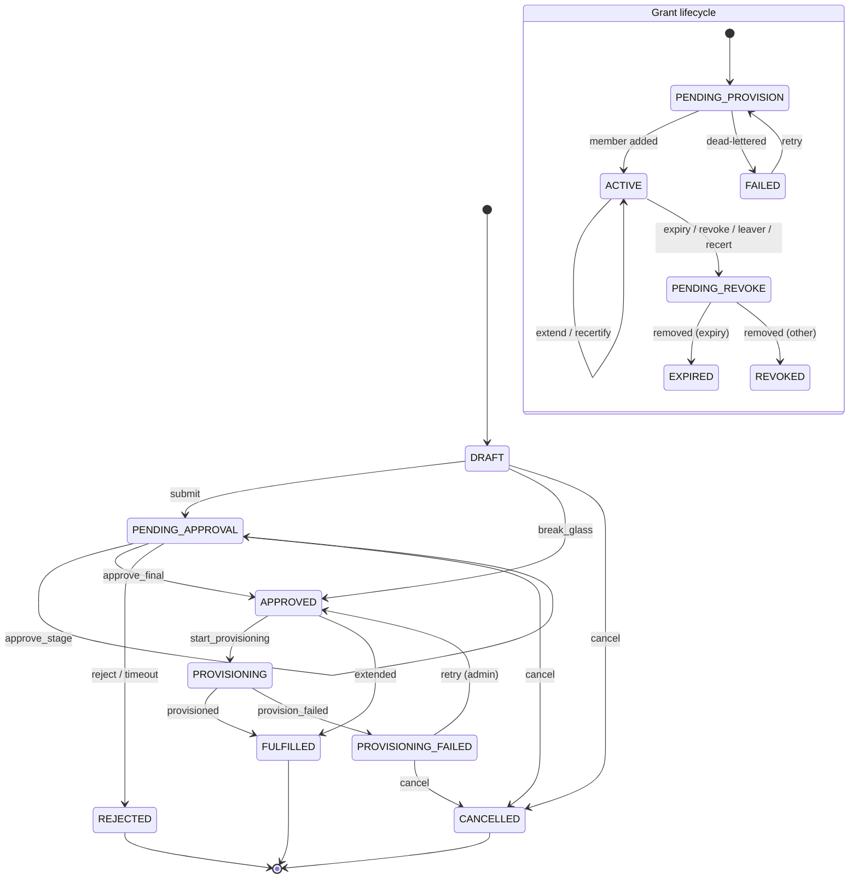
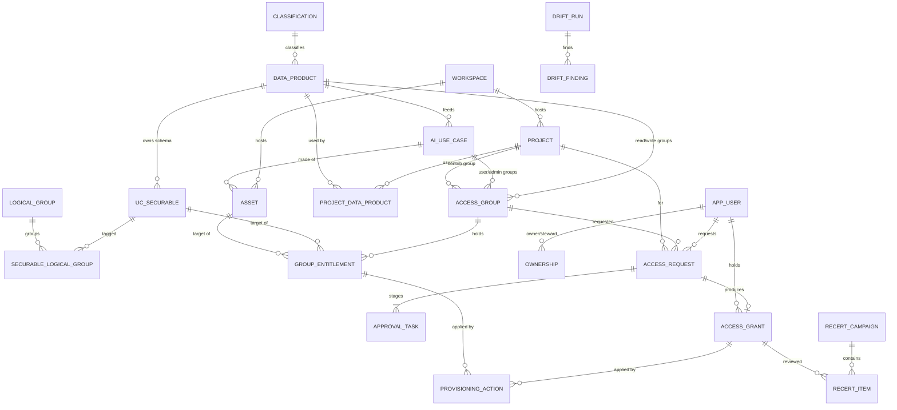
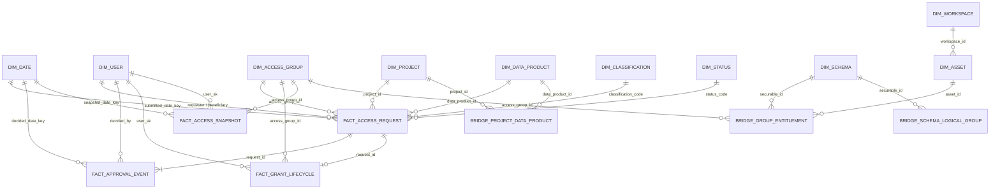

# Data Access Workflow App: requirements specification

Version 1.1, October 2026 (two-app design). Status: draft for design governance review.

This document specifies a Databricks App (Python, SQL) that manages requests, approvals, provisioning, recertification and revocation of access to the Azure Databricks data platform, for a UK pensions business regulated by the FCA and subject to UK GDPR. The code in this repository implements it; section references (FR-x) are cited in the code where useful.

## 1. Business context

### 1.1 Problem

Access to Unity Catalog data products, Genie spaces, AI endpoints and Power BI workspaces is granted today through tickets and manual group changes. Approvals are not consistently evidenced, access is rarely removed when no longer needed, and there is no single place that answers "who can see member data, why, and who approved it". This creates conduct and data-protection risk (UK GDPR Articles 5(1)(f) and 32, FCA SYSC 3 and 6 on systems and controls) and makes audit and recertification expensive.

### 1.2 Goals

The app gives every access path a recorded owner, purpose, approval and end date. It turns approved requests into Entra ID group memberships automatically, so that nobody is granted access directly. It removes access when it expires, when a person leaves, or when a reviewer does not re-confirm it. It detects and reports access that was granted outside the app. It produces audit evidence on demand.

Success measures: 100% of grants on governed securables held by app-managed groups; median time from request to access under 2 working days for General data; recertification completion above 98% per campaign; zero unexplained high-severity drift findings older than 5 working days.

### 1.3 Scope summary

The app registers and maintains projects, data products (one UC schema each in the dbanalytics catalog), catalogs, schemas and optionally tables, workspaces by type (ingestion, project, dbanalytics, Analytics/Power BI, MLops), Entra access groups, Power BI workspaces and semantic models, AI assets (Genie spaces, AI Function and serving endpoints, agents), and owners and stewards. Projects and data products are many-to-many. Users request access for a project, to a data product or asset, at a privilege level; requests are approved, provisioned, expired, recertified and revoked.

### 1.4 Stakeholders

| Stakeholder | Interest |
|---|---|
| Data consumers (analysts, actuaries, data scientists) | Fast, predictable access with clear status |
| Data owners (business heads per data product) | Control over who uses their data and why |
| Data stewards | Correct classification and appropriate use |
| Information security | Least privilege, break-glass control, drift visibility |
| Data protection officer | Lawful, minimal, time-bound access to personal data |
| Platform team | Fewer tickets, no manual grants, reliable automation |
| Internal audit / 2nd line risk | Complete, tamper-evident evidence |
| Identity (Entra) team | Group hygiene, naming and lifecycle |

### 1.5 Applications and in-app roles

The solution is two Databricks Apps over one Lakebase schema:

| App | Audience | Purpose |
|---|---|---|
| **Data access** (`cdp-security-<env>`) | Every user | Request, extend and give up access; approve; review access; emergency access; data-owner tools (project links, who has access to my data) |
| **Catalog admin** (`cdp-security-admin-<env>`) | Platform admins, auditors, security | Register workspaces, data products, projects, assets, AI use cases, groups, entitlements and owners; operations; audit trail, drift and evidence |

| Role | Source | Can do |
|---|---|---|
| Requester | Any signed-in user | Request access for self or another person, extend, cancel own requests, give up access, set approval delegates |
| Approver | Contextual: data owner, steward or project sponsor of the requested object, their delegate, or a security approver | Approve or reject the stage assigned to their role |
| Data owner | Ownership record on a data product, AI use case, project or group | Approve, link projects to their data products, revoke access to their data, review access in campaigns |
| Steward | Ownership record (role STEWARD) | Second-stage approval for Confidential and Restricted; fallback recertification reviewer |
| Admin | Entra group `grp-dbx-<env>-app-cdp_security-admin` | Register reference data, manage entitlements, retry provisioning, retire groups. Cannot approve requests by virtue of the role |
| Auditor | Entra group `...-auditor` | Read audit trail, drift findings and evidence; no changes |
| Security | Entra group `...-security` | Approve Restricted stage 3, review break-glass, accept drift risk |
| Break-glass | Entra group `...-breakglass` | Obtain time-boxed emergency access with post-hoc review |

## 2. Functional requirements

Each requirement is testable. "Must" is mandatory for go-live.

### 2.1 Reference data management

- **FR-1** An admin must be able to register a workspace with name, type (INGESTION, PROJECT, DBANALYTICS, ANALYTICS_PBI, MLOPS), URL and environment. URLs must be https.
- **FR-2** An admin must be able to register a data product with a unique code, a catalog and schema (one schema per data product), a classification, a data owner and a steward. For Confidential and Restricted, owner and steward must be different people.
- **FR-3** Registering a data product must create, by default, a `-read` group (requestable) and a `-write` group (not requestable) with template entitlements: read = USE CATALOG, USE SCHEMA, SELECT, EXECUTE; write = read + MODIFY.
- **FR-4** An admin must be able to register a project with sponsor, optional project workspace and end date, and optionally a `-contrib` group.
- **FR-5** A project may be linked to many data products and a data product to many projects. Only the data product's owner (in the Data access app) or an admin (in the Catalog admin app) may create a link, with a justification.
- **FR-5a** Owners and stewards must be able to see, in the Data access app, which projects may use their data products and who currently has access, and owners must be able to remove a person's access.
- **FR-6** An admin must be able to register assets (Genie space, serving endpoint, AI Function endpoint, agent, AI/BI dashboard, Power BI workspace, Power BI semantic model) with their external id and owning workspace.
- **FR-7** Registering an AI use case must create exactly two groups, `-user` and `-admin`, with template permissions on its assets and, by default, read on the underlying data product (Genie answers with the caller's UC permissions).
- **FR-8** Tables or schemas may be assigned to multiple logical groups (Customer, Finance, Risk, Regulatory).
- **FR-9** Group names must follow `grp-dbx-<env>-<dp|prj|ai|ws>-<code>-<level>`; the app must reject names that do not.
- **FR-10** An admin must be able to add or remove a group entitlement on a UC securable or asset. Only allow-listed privileges are accepted; MANAGE, OWNERSHIP and ALL PRIVILEGES can never be granted through the app; management-level asset permissions can only be held by ADMIN-level groups; write privileges cannot be held by READ or USER groups.
- **FR-11** Approval routes and classification limits must be changeable only by database migration (that is, through design governance), never through the UI.
- **FR-12** Ownership assignments must be time-stamped and ended rather than deleted.

### 2.2 Request workflow

- **FR-13** A user must be able to request a requestable group for themselves or another person, with a justification of at least 20 characters and a duration.
- **FR-14** Confidential and Restricted requests must name an active project that is linked to the data product; project-purpose groups must match their project.
- **FR-15** Duration must be capped at the classification maximum (General 365, Confidential 180, Restricted 90 days) and at the project end date.
- **FR-16** A person may have only one open request and one live grant per group; duplicates must be refused with guidance to extend instead.
- **FR-17** Each request must receive a human-readable reference (SAR-nnnnnnn).
- **FR-18** A requester or beneficiary may cancel a request while it is pending approval; an admin may cancel a request whose provisioning failed. Approved requests cannot be cancelled (revoke the grant instead).
- **FR-19** A grantee may request an extension of an active, non-break-glass grant; it follows the same approval route; on approval the end date is moved, not a new grant created.
- **FR-20** Users must see status, current stage and history of their requests.

### 2.3 Approval rules by classification

- **FR-21** Stages are sequential: General = data owner; Confidential = data owner, then steward; Restricted = data owner, then steward, then security.
- **FR-22** If a classification has no configured stages or has gaps, requests must fail closed with an error.
- **FR-23** The requester and beneficiary can never approve any stage of their own request.
- **FR-24** A person may approve at most one stage of a request.
- **FR-25** An approver may delegate to another person for up to 60 days; delegates decide "on behalf of" and this is recorded. Delegation does not pass authority from a conflicted person.
- **FR-26** Rejection requires a comment of at least 5 characters.
- **FR-27** Each stage has an SLA in UK business hours (weekends and configured bank holidays excluded). On breach the task is escalated to approvers and admins; after the auto-reject threshold (default 240 business hours past due) the request is closed.
- **FR-28** If no eligible approver exists for a stage, admins must be alerted immediately.
- **FR-29** Owner and steward resolution must use the most specific object first: group, then AI use case or project, then data product.

### 2.4 Provisioning

- **FR-30** Approval must record desired state only; a provisioning job applies it. The job runs every 15 minutes and is triggered immediately after a final approval or break-glass.
- **FR-31** Users are only ever added to Entra groups; grants are only ever made to groups.
- **FR-32** The job must apply UC grants and revokes, workspace object permissions (Genie, serving endpoints, dashboards) and Power BI workspace and semantic model access for groups.
- **FR-33** Every action must be idempotent and safe to retry; concurrent runs must not process the same action.
- **FR-34** Transient failures retry with exponential backoff up to 6 attempts; permanent failures (user not found, missing permissions) are dead-lettered immediately; admins are alerted and can retry after fixing the cause.
- **FR-35** If an Entra group has not yet synced to Databricks, the action is deferred without consuming an attempt.
- **FR-36** Group creation in Entra is configurable: created by the app, or created by the identity team with the object id recorded by an admin.
- **FR-37** A dry-run mode must record every decision and transition while changing nothing in Entra, UC or Power BI.

### 2.5 Lifecycle

- **FR-38** Expiry: access must be removed on the end date. Notices are sent 14 and 3 days before.
- **FR-39** Recertification: each grant must be re-confirmed within its classification interval (General 365, Confidential 180, Restricted 90 days). Items are added 14 days before due; the reviewer is the data owner, falling back to steward or group owner, never the grantee.
- **FR-40** Items not reviewed by the campaign due date must be revoked (fail closed).
- **FR-41** Leavers: a person disabled or deleted in Entra must lose all access within one daily cycle; their open requests are cancelled; admins are told about objects they owned.
- **FR-42** Movers: a department change must place the person's grants in a mover review campaign due in 7 days.
- **FR-43** Joiners receive no access automatically.
- **FR-44** Break-glass: members of the break-glass group may obtain access to an active group with an incident reference; it lasts 4 hours (configurable), cannot be extended, alerts security by email and Teams immediately, and must be reviewed by security within 24 hours. A rejected review revokes access and raises a security alert.
- **FR-45** Retiring a group must revoke all members, cancel open requests and remove all entitlements; the group is marked retired once nothing remains.

### 2.6 Notifications

- **FR-46** Notifications must be written to an outbox in the same transaction as the change and sent by a job (email via Graph from a service mailbox; security alerts also to a Teams channel).
- **FR-47** Messages carry request metadata only, never data content.
- **FR-48** Non-production messages must be prefixed with the environment.
- **FR-49** Failed sends retry up to 5 times and are visible to admins.

### 2.7 Reporting and audit views

- **FR-50** Auditors must be able to search the audit trail by date, actor and reference, export it as CSV, and verify its integrity.
- **FR-51** An evidence pack must list every live grant with classification, project, dates, last recertification and the full approval trail.
- **FR-52** A daily star schema in Delta must support reporting on request volumes, SLA performance, access by classification, overdue recertification and break-glass use.
- **FR-53** Drift findings must be visible, with acknowledge, remediate and (security only) accept-risk actions requiring a note.

## 3. Workflow state model

### 3.1 Request states

| From | Event | To | Triggered by |
|---|---|---|---|
| DRAFT | submit | PENDING_APPROVAL | requester |
| DRAFT | break_glass | APPROVED | break-glass member |
| DRAFT, PENDING_APPROVAL | cancel | CANCELLED | requester, beneficiary |
| PENDING_APPROVAL | approve_stage | PENDING_APPROVAL (next stage) | eligible approver |
| PENDING_APPROVAL | approve_final | APPROVED | eligible approver |
| PENDING_APPROVAL | reject | REJECTED | eligible approver |
| PENDING_APPROVAL | timeout | REJECTED | system (SLA) |
| APPROVED | start_provisioning | PROVISIONING | system |
| APPROVED | extended | FULFILLED | system (EXTEND requests) |
| PROVISIONING | provisioned | FULFILLED | system |
| PROVISIONING | provision_failed | PROVISIONING_FAILED | system |
| PROVISIONING_FAILED | retry | APPROVED | admin |
| PROVISIONING_FAILED | cancel | CANCELLED | admin, requester |

### 3.2 Grant states

| From | Event | To |
|---|---|---|
| PENDING_PROVISION | provisioned | ACTIVE |
| PENDING_PROVISION | provision_failed | FAILED |
| FAILED | retry | PENDING_PROVISION |
| ACTIVE | extend, recertify | ACTIVE |
| ACTIVE | revoke (self, owner, admin, expiry, recert, leaver, post-hoc rejection, group retired) | PENDING_REVOKE |
| PENDING_REVOKE | removed | EXPIRED (if reason is expiry) or REVOKED |

### 3.3 SLAs and escalation

| Item | SLA | Escalation |
|---|---|---|
| General, owner stage | 72 business hours | Email approvers and admins at breach; close at 240 hours past due |
| Confidential, each stage | 72 business hours | As above |
| Restricted, each stage | 48 business hours | As above; security stage also alerts the security channel |
| Break-glass review | 24 calendar hours | Security channel and admins; never auto-closed |
| Provisioning after approval | 15 minutes target | Dead letters alert admins |
| Leaver removal | Next daily run (06:30) | Not applicable |

## 4. Data model

### 4.1 Operational model and store choice

The operational model is normalised (3NF) and lives in **Lakebase** (Databricks-managed PostgreSQL), schema `cdp_security`.

| Criterion | Lakebase (recommended) | Delta tables via SQL warehouse |
|---|---|---|
| Small concurrent writes | Row-level locking, millisecond commits | Optimistic file-level concurrency; conflicts under concurrent updates |
| Transactions across tables | Full ACID, multi-statement | Single-table atomicity only |
| Constraints | PK, FK, CHECK, unique and partial unique indexes enforced | PK/FK informational only; CHECK supported |
| Append-only audit with hash chain | Triggers block UPDATE/DELETE and compute the chain | `delta.appendOnly` blocks updates but no chain |
| Queue semantics (SKIP LOCKED) | Native | Not available |
| App latency | Low, no warehouse warm-up | Warehouse start-up and per-query overhead |
| Analytics | Reporting job reads Lakebase over Postgres into Delta in an existing catalog | Native |
| Cost | Small always-on instance (CU_1/CU_2) | Warehouse time per interaction |
| Operational maturity | Newer service; validate HA, backup and PITR settings | Mature |

Trade-off accepted: Lakebase for the workflow, Delta for reporting and long-term audit retention. If Lakebase is not approved for your tenant, the code isolates data access in `db.py`, `service.py` and `queries.py`; a Delta implementation would need optimistic-version checks in place of row locks and a separate queue mechanism.

Main operational tables: `classification`, `app_user`, `app_role_member`, `workspace`, `data_product`, `project`, `project_data_product`, `logical_group`, `uc_securable`, `securable_logical_group`, `ai_use_case`, `asset`, `access_group`, `group_entitlement`, `ownership`, `approval_rule`, `delegation`, `access_request`, `approval_task`, `access_grant`, `provisioning_action`, `recert_campaign`, `recert_item`, `drift_run`, `drift_finding`, `notification_outbox`, `audit_event`. Full DDL: `sql/lakebase/001_schema.sql`.

### 4.2 Dimensional model for reporting and audit

Location: Delta, `cdp_security_<env>.reporting`. Built daily by `jobs/reporting_etl.py`. DDL: `sql/reporting/001_reporting_ddl.sql`.

| Table | Type | Grain |
|---|---|---|
| fact_access_request | Transaction fact | One row per access request |
| fact_approval_event | Transaction fact | One row per approval task (stage) of a request |
| fact_grant_lifecycle | Accumulating snapshot | One row per grant; milestones (requested, approved, provisioned, recertified, revoke requested, revoked) filled as they occur |
| fact_access_snapshot | Periodic snapshot | One row per live grant per day (partitioned by date) |
| dim_user | SCD type 2 | One row per version of a user (department, active status) |
| dim_access_group, dim_project, dim_data_product, dim_schema, dim_workspace, dim_asset, dim_classification, dim_status, dim_date | SCD type 1 | One row per entity |
| bridge_project_data_product | Bridge | Project to data product |
| bridge_group_entitlement | Bridge | Group to securable or asset with privilege |
| bridge_schema_logical_group | Bridge | Securable to logical group |
| audit_event_archive | Append-only | One row per audit event, retained for the regulatory period |

Facts join to `dim_user` at the point in time of the event (SCD2 effective dates), so a report shows the department a person was in when they were approved.

## 5. Provisioning approach

The app records **desired state** (groups, entitlements, grants) in Lakebase; a job applies it.

1. **Plan.** The provisioning job derives actions from desired state: create groups that are planned, add members for grants pending provisioning, remove members for grants pending revocation, apply or revoke entitlements that are pending. Each action has an idempotency key.
2. **Claim.** Due actions are claimed with `FOR UPDATE SKIP LOCKED`, so overlapping runs never double-process.
3. **Execute.** External calls happen outside database transactions; outcomes are recorded afterwards. Graph, UC and Permissions API calls are idempotent, so a retry after a crash is harmless.
4. **Record.** State transitions, audit events and notifications commit together.

**Systems changed:**

| Target | Mechanism | Identity |
|---|---|---|
| Entra group membership and group creation | Microsoft Graph | App registration with GroupMember.ReadWrite.All, User.Read.All, Group.Create (optional) |
| Unity Catalog grants | `GRANT` / `REVOKE` via Spark SQL | Provisioning SP with MANAGE on governed catalogs |
| Genie spaces, serving endpoints, dashboards | Databricks Permissions API per workspace | Provisioning SP added to each workspace |
| Power BI workspaces and semantic models | Power BI REST API | SP enabled in Power BI tenant settings, Admin on governed workspaces |

**Drift detection (daily).**

- Unity Catalog: direct (non-inherited) privileges from `system.information_schema.catalog_privileges`, `schema_privileges` and `table_privileges` on registered securables are compared with applied entitlements. Findings: missing grant, unexpected grant to an app-managed group, direct user grant (policy is groups only), and any unmanaged grantee on a Restricted securable.
- Out-of-band changes: `system.access.audit` rows where `service_name = 'unityCatalog'` and `action_name = 'updatePermissions'` by anyone other than the provisioning SP or allow-listed principals.
- Membership: Graph members of each managed group compared with active grants (pending grants tolerated).
- Findings are de-duplicated by fingerprint, auto-resolved when no longer seen, and missing grants can optionally be re-applied automatically. Unexpected access is never removed automatically; security decides.

**Entra group lifecycle.**

| Stage | What happens |
|---|---|
| Planned | Created in the app with a convention-checked name when a data product, AI use case or project is registered |
| Active | Created in Entra by the app (if enabled) or by the identity team, object id recorded; synced to Databricks by automatic identity management or SCIM; entitlements applied once visible |
| Retiring | Requestable switched off, members revoked, entitlements removed |
| Retired | Nothing remains; the identity team may delete the Entra group |

**Naming convention.** `grp-dbx-<env>-<purpose>-<code>-<level>`

| Purpose | Code | Levels | Example |
|---|---|---|---|
| dp (data product) | data product code | read, write | grp-dbx-prd-dp-member_contributions-read |
| ai (AI / Genie use case) | use case code | user, admin | grp-dbx-prd-ai-member_contributions_genie-user |
| prj (project) | project code | read, contrib, admin | grp-dbx-prd-prj-forecast_2026-contrib |
| ws (workspace) | workspace code | user, admin | grp-dbx-prd-ws-mlops-user |
| app (this app's roles) | cdp_security | admin, security, auditor, breakglass | grp-dbx-prd-app-cdp_security-admin |

## 6. Security of the app

**Identities.** Each app runs as its own service principal with Lakebase access only (no Unity Catalog data privileges). The jobs run as a separate provisioning service principal, the only identity with MANAGE on governed catalogs and Graph or Power BI credentials. Both apps can trigger, but not edit, the provisioning job (CAN_MANAGE_RUN). The Catalog admin app can only be opened by the admin, auditor and security groups.

**On-behalf-of versus app identity.** User authorisation is enabled with a single scope, `iam.current-user:read`, used only to read the caller's group memberships for role resolution. All writes are made by the App service principal and attributed to the user in the audit trail. Using OBO for data changes is rejected because it would require every requester to hold rights to change grants.

**Least privilege in Lakebase.** All tables sit in one `cdp_security` schema; separation is enforced by per-role table grants (`sql/lakebase/roles_template.sql`), re-applied by the migrate job after every migration.

| Table group | Data access app role | Catalog admin app role | Jobs role |
|---|---|---|---|
| classification, approval_rule | read | read | owner (changed by migration only) |
| workspace, data_product, project, uc_securable, asset, ai_use_case, access_group, ownership, logical-group links | read | read, insert, update | owner |
| project_data_product | read, insert (data owners) | read, insert, update | owner |
| group_entitlement | none | read, insert, update | owner |
| access_request, approval_task, access_grant | read, insert, update | read, update (retire group, retry) | owner |
| delegation, recert_item | read, insert / update | read | owner |
| app_user | read, insert, update | read, insert, update | owner |
| app_role_member | read | read, insert, delete | owner |
| provisioning_action, drift_finding | none | read, update | owner |
| audit_event | insert only | read, insert | owner (UPDATE/DELETE blocked by triggers) |

Neither app can UPDATE or DELETE audit rows or change approval rules. The audit chain trigger runs with the schema owner's rights, so the Data access app appends to the same chain without being able to read it. A write attempted by the wrong app is refused by Postgres, not just by application code.

**Network.** The App and jobs run on serverless compute. Lakebase traffic stays inside Databricks. Serverless egress (network policies under your NSP/NCC design) must allow only `login.microsoftonline.com`, `graph.microsoft.com`, `api.powerbi.com` and the Teams workflow host. The App should be reachable only through the workspace (private link front-end where used). No secrets are stored in code or in Lakebase; credentials live in a Key Vault-backed secret scope readable only by the provisioning SP.

**Segregation of duties.** Administering the catalog and approving access happen in different apps under different database roles: the Catalog admin app cannot create requests or approval decisions at all. Requesters and beneficiaries cannot approve; one person approves at most one stage; admins administer but do not approve; data owner and steward must differ for Confidential and Restricted; reviewers cannot recertify their own access; admins cannot change their own app roles; approval routes change only through governed migrations.

**Application hardening.** Parameterised SQL everywhere; UC statements are built from allow-listed privileges and quoted identifiers; group names must match the convention before any grant; XSRF protection on; errors shown to users never include stack traces.

## 7. Audit and compliance

**Append-only event log.** Every state change writes an `audit_event` row in the same transaction as the change, with actor, action, object, before and after state, reason and correlation id (the request reference). A trigger assigns a strictly increasing sequence and a SHA-256 hash chained to the previous event; triggers block UPDATE, DELETE and TRUNCATE. `verify_audit_chain()` proves integrity and is available on the Audit page.

**Retention.** The audit trail is copied daily to `audit_event_archive` (Delta, append-only). Recommended retention: 7 years after the end of the access relationship, aligned with your records retention schedule; confirm with Compliance and the DPO. After retention, personal identifiers should be pseudonymised rather than rows deleted, preserving chain verification of the remaining fields.

**Evidence for recertification.** For each campaign: the item, reviewer, decision, timestamp and comment; for each live grant, the evidence pack (FR-51) shows approvals and last recertification. Unattested items are revoked automatically and evidenced as `RECERT_NOT_ATTESTED`.

**GDPR.** Processing purpose: security of processing and access control (Art. 32), lawful basis legitimate interests and legal obligation. Data minimisation: the app stores work email, display name and department only. Reporting tables containing emails are restricted to auditors and security. Subject access requests can be answered from the audit and grant tables.

**FCA alignment.** Supports SYSC 3.2 and 6.1 systems and controls, operational resilience evidence (who could access important business services' data), and SM&CR accountability through named data owners.

## 8. Non-functional requirements

| Area | Requirement |
|---|---|
| Environments | dev, tst, prd, each with its own Lakebase instance, reporting catalog, app and groups. Dev runs in dry-run mode |
| Deployment | Databricks Asset Bundle (`databricks.yml`); CI runs unit tests, the Postgres integration test and `bundle validate`, then deploys to tst; prd deployment requires a governance approval gate |
| Schema change | Numbered, checksummed Lakebase migrations applied by `cdp_security-migrate`; applied files cannot be edited |
| Performance | Page loads under 2 seconds at 95th percentile for up to 200 concurrent users; submit or decide under 1 second |
| Throughput | 2,000 provisioning actions per hour; the audit hash chain serialises writes, which is adequate at this volume |
| Availability | Business hours 99.5%; if the App is down, existing access is unaffected; if provisioning is down, approvals queue and catch up |
| Recovery | Lakebase point-in-time restore enabled; RPO 15 minutes, RTO 4 hours |
| Observability | Job run history and failure alerts; Operations page for dead letters and failed notifications; drift summaries; structured logs with error references |
| Accessibility | WCAG 2.2 AA for custom content; Streamlit defaults otherwise |
| Cost | One small Lakebase instance per environment, compute for two apps (the Catalog admin app can be stopped out of hours), a 15-minute serverless job (about 96 short runs a day) and one daily job. Reduce provisioning frequency in dev |
| Security testing | Penetration test of the App before go-live; quarterly access review of the app's own admin groups |

## 9. Assumptions, open questions, risks and scope

### 9.1 Assumptions

- A1. Entra ID is the identity source; groups sync to Databricks via automatic identity management or SCIM.
- A2. All governed workspaces share one Unity Catalog metastore.
- A3. Lakebase is approved for use in the tenant and region.
- A4. A dedicated provisioning service principal can be granted MANAGE on governed catalogs and the Graph permissions listed in section 5.
- A5. Data products are one schema each in dbanalytics; classification tags are applied by CI/CD and the app's classification matches them.
- A6. A service mailbox and a security Teams channel exist for notifications.

### 9.2 Open questions for you

1. Is there an ITSM tool (for example ServiceNow) that must remain the system of record for requests? If so, this app becomes the governance and provisioning layer and needs an integration.
2. Will the app create Entra groups, or will the identity team? This sets `graph_create_groups`.
3. Should Restricted access also need line-manager approval? If so, a manager source (Entra `manager` attribute) is needed.
4. Who are the security approvers and break-glass members, and what is the break-glass duration your security policy accepts?
5. Should write access to production data products ever be requestable, or only granted to pipelines?
6. Should the app sync UC classification tags from CI/CD into its own records, or is the app the source of the classification?
7. Retention period for the audit archive and the pseudonymisation approach after it.
8. Should table-level (rather than schema-level) entitlements be supported for Restricted tables via ABAC policies?
9. Which workspaces host the App in each environment, and is front-end private link in use?
10. Are Power BI workspaces in scope at go-live, or a later phase?

### 9.3 Risks

| Risk | Impact | Mitigation |
|---|---|---|
| Provisioning SP is a high-value target | Could grant itself or others broad access | No interactive use, secrets in Key Vault, MANAGE not OWNER, drift detection flags its out-of-band changes, alerting on its sign-ins |
| Entra-to-Databricks sync delay | Access appears late | Deferral without consuming attempts; user message explains up to an hour |
| Lakebase maturity | Outage blocks requests | Existing access unaffected; PITR; documented Delta fallback |
| Owners not maintained | Requests stall, reviews fail | No-approver alerts, leaver-owner alerts, delegation |
| Permissions API rewrite on revoke | Concurrent manual edits overwritten | Workspace object ACLs are managed only by the app; drift detection |
| Review fatigue | Rubber-stamping | Monthly buckets, per-reviewer summaries, reports on keep-rate per reviewer |
| Restricted data in justifications | Personal data in free text | Guidance text in the form, retention controls |

### 9.4 Out of scope

- Row filters, column masks and ABAC policy authoring (the app grants coarse access; fine-grained controls stay with your governance CI/CD).
- Granting compute, cluster policies or SQL warehouse entitlements.
- Azure resource RBAC, storage account and Key Vault access.
- Unity Catalog object ownership transfers.
- Access for service principals and pipelines (managed through infrastructure as code).
- Self-service creation of new data products (registration only).
- Delta Sharing recipients.
