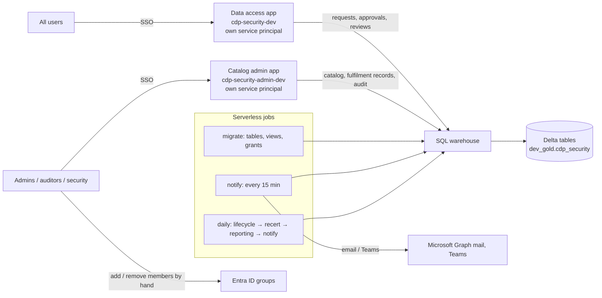

# CDP Security: the complete guide

This guide is for an engineer who is new to Databricks and new to this project. It explains:

1. [What the system does](#1-what-the-system-does)
2. [The Databricks concepts you need](#2-databricks-concepts-you-need)
3. [How the pieces fit together](#3-how-the-pieces-fit-together)
4. [How deployment works, step by step](#4-how-deployment-works-step-by-step)
5. [The dev environment](#5-the-dev-environment)
6. [Every file, explained](#6-every-file-explained)
7. [The data model](#7-the-data-model)
8. [Security model](#8-security-model)
9. [Operating it: common tasks](#9-operating-it-common-tasks)
10. [Going to tst / prd](#10-going-to-tst--prd)
11. [Troubleshooting](#11-troubleshooting)

---

## 1. What the system does

People need access to data products: AI/BI dashboards, Power BI reports, Genie agents, custom agents, Databricks
apps and Unity Catalog schemas. Access is given by membership of an Entra ID group. This system is the **record
of who asked, who approved, and who changed the group**, for audit and reporting. **It never changes a group or a
permission itself**: admins do that by hand and record it here.

1. A platform admin **registers** workspaces, data products (a type, an optional project, an optional catalog and
   schema, a data owner and a steward) and the Entra ID **groups** that give access to each data product. Every
   registered item gets a generated identifier: `WS-0001`, `DP-0001`, `GRP-0001`. A group is validated before it
   is saved.
2. A user **requests** access to a data product.
3. The right people **approve** it. How many approvals depends on how sensitive the data is:
   - GENERAL: data owner (1 stage)
   - CONFIDENTIAL: data owner, then steward (2 stages)
   - RESTRICTED: data owner, then steward, then security (3 stages)
4. An admin **adds the person to the group by hand**, then marks it *granted* on the **Fulfilment** page. The app
   records who did it and when. Access ends on the date the requester chose.
5. Access has an **end date**, and owners must **recertify** (re-confirm) it periodically. Access that ends or is
   revoked is listed for an admin to **remove by hand** and mark *removed*.
6. Every action is written to a **tamper-evident audit trail** (each row contains a hash of the previous row), and
   the reporting model shows how long each manual change took after approval.

There are two web apps over one schema of Delta tables:

- **Data access** (`cdp-security-dev`) for everyone: My access, Request access, Approvals, Access reviews,
  My data products, Emergency access (break-glass).
- **Catalog admin** (`cdp-security-admin-dev`) for admins, auditors and security: register and edit workspaces,
  data products and groups; Fulfilment (record manual adds and removals); audit trail and evidence pack.

---

## 2. Databricks concepts you need

| Concept | What it is | How this project uses it |
|---|---|---|
| **Workspace** | Your Databricks environment, reached at a URL like `adb-<id>.<n>.azuredatabricks.net`. | Everything is deployed into `adb-7405607693517995.15`. |
| **Unity Catalog (UC)** | Databricks' permission and metadata layer. Data is organised as **catalog → schema → table** (`dev_gold.cdp_security.access_request`). | All of the app's tables live in the existing catalog `dev_gold`, schema `cdp_security`. A schema data product names its catalog and schema; the app never grants on it. **This project never creates catalogs.** |
| **Delta table** | The table format Unity Catalog uses. Supports UPDATE, DELETE, MERGE and CHECK constraints, but not transactions across several tables, and primary / foreign keys are not enforced. | Every table of the app. Section [3](#key-design-ideas) explains how the rules are still kept. |
| **SQL warehouse** | Compute that runs SQL. *Serverless* warehouses start in seconds and stop when idle. | Both apps and all jobs read and write through one warehouse (dev: *Serverless Starter Warehouse*, `3563e74db5969657`). |
| **Declarative Automation Bundles (Asset Bundles)** | "Infrastructure as code" for Databricks. A `databricks.yml` file describes apps, jobs, etc.; `databricks bundle deploy` creates or updates them. | `databricks.yml` + `resources/*.yml` describe everything. |
| **Target** | A named environment inside a bundle (`dev`, `tst`, `prd`), each with its own workspace URL and variable values. | `dev` is the default; `tst`/`prd` are prepared but not deployed. |
| **Development mode** | `mode: development` on a target: resources are prefixed with `[dev <your name>]`, deployed under your user folder, and run as you. | The dev target. Jobs appear as `[dev naveen9712] cdp_security-...`. |
| **Databricks Apps** | Hosted web apps (Streamlit, Dash, Flask, ...) that run inside Databricks. Users sign in with their normal Databricks login (SSO). Each app gets its **own service principal**. | The two Streamlit apps. |
| **Service principal (SP)** | A non-human identity (like a robot user) identified by an application id (a UUID). | Each app runs as its own SP, with its own table grants. In tst/prd, jobs run as a jobs SP. |
| **On-behalf-of user token** | Apps can receive the signed-in user's token (header `X-Forwarded-Access-Token`), limited by *scopes*. | Used **only** to read the user's own group memberships (default scope `iam.current-user:read`). |
| **Jobs (Lakeflow Jobs) / serverless** | Scheduled or on-demand runs of Python files or notebooks. *Serverless* means Databricks provides the compute. | Three jobs: migrate, notify, daily. All serverless. |
| **Secret scope** | A named store of secrets (often backed by Azure Key Vault), read with `dbutils.secrets.get`. | Scope `cdp_security` will hold Graph (email, leaver checks) / Teams credentials. **Not needed in dev** (dry run). |
| **OAuth U2M / M2M** | U2M = a user logs in through the browser (`databricks auth login`). M2M = a service principal authenticates with a client id + secret. | You deploy with U2M (profile `Dev`). Apps and jobs authenticate as themselves automatically. |
| **Entra ID groups** | Azure AD security groups. Databricks syncs them, so UC permissions can be granted to them. | Admins add people to the registered groups by hand (suggested name `grp-dbx-<env>-dp-<name>-read`). |

---

## 3. How the pieces fit together



Nothing in the system writes to Entra ID or to Unity Catalog permissions on data products.

### The life of one request

1. **Register.** An admin registers data product `DP-0001` (type *Schema*, `dbanalytics.member_contributions`)
   and validates, then registers, group `GRP-0001` `grp-dbx-dev-dp-member_contributions-read`, which the identity
   team created in Entra ID. The admin gives that group its permissions on the schema (or the dashboard, report,
   agent or app) by hand, once.
2. **Request.** Alice asks for access. `service.submit_request` validates it, writes an `access_request` row with
   the next reference (`SAR-0000001`) and a stage-1 `approval_task`, writes an audit event and queues a
   notification to the data owner.
3. **Approve.** Bob (data owner) sees it on the Approvals page. `service.decide_task` checks segregation of duties
   (Bob is not Alice, did not approve an earlier stage, ...). If more stages remain, the next task is created;
   otherwise an `access_grant` row is created with status `PENDING_PROVISION` (*awaiting admin*) and the admin
   mailbox is told to add Alice.
4. **Add by hand.** An admin adds Alice to the group in Entra ID, then on **Fulfilment → To add** marks it
   granted (`service.mark_granted`). The grant becomes `ACTIVE` and the request `FULFILLED`; access ends on the
   date Alice chose (emergency access gets its full 4 hours from now). An admin cannot record access given to themselves.
5. **End / recertify / revoke.** When the end date passes, `lifecycle.expire_grants` marks the grant
   `PENDING_REVOKE` (it also shows on **To remove** as soon as it ends). Owners can revoke; recertification
   campaigns ask owners to re-confirm and anything not confirmed is revoked. In every case an admin removes Alice
   from the group by hand and marks it removed (`service.mark_removed`).
6. **Report.** The daily job refreshes the reporting tables; `v_manual_fulfilment` shows who added or removed
   each member and how long after approval.

### Key design ideas

- **The app records, people change.** The apps and jobs never call Entra ID or grant anything on data products.
  Each manual change is recorded with who, when and an optional note, and audited.
- **One statement checks and changes.** Delta has no transactions across tables, so every rule that must hold
  when two people act at once is written as a single statement that checks and changes together, for example
  `UPDATE approval_task SET status = 'APPROVED' ... WHERE task_id = :id AND status = 'PENDING'` or
  `INSERT ... SELECT ... WHERE NOT EXISTS (an open request for the same person and group)`. The code checks the
  number of affected rows. Every table uses *Serializable* isolation, so two such statements racing on the same
  table conflict and the losing one is retried (`db.py`).
- **Generated identifiers without gaps.** `WS-`, `DP-`, `GRP-` and `SAR-` numbers are computed as `max + 1` inside
  the inserting statement, so they are consecutive; a race is a conflict and is retried.
- **Two apps, two identities.** Each app's service principal gets its own per-table grants
  (`app/cdp_security/appgrants.py`). The Data access app cannot change workspaces, data products or groups,
  because Unity Catalog refuses it.
- **Everything is audited.** `audit.record` is called straight after each change. The audit table is append-only
  and every row carries the hash of the previous one.

---

## 4. How deployment works, step by step

### 4.1 Prerequisites on your laptop

- The Databricks CLI. It ships with the VS Code Databricks extension
  (`~/.vscode/extensions/databricks.databricks-*/bin/databricks`), or install it with
  `brew install databricks/tap/databricks`.
- A logged-in profile (OAuth U2M, opens a browser once):
  ```bash
  databricks auth login --host https://adb-7405607693517995.15.azuredatabricks.net --profile Dev
  databricks auth describe -p Dev          # check who you are logged in as
  ```

### 4.2 What `databricks bundle deploy -t dev -p Dev` does

1. **Reads `databricks.yml`** and every file matched by `include: resources/*.yml`, picks the `dev` target, and
   resolves `${var.*}` variables.
2. **Runs the `preinit` script.** It copies `app/` to `build/admin_app/`. (Two apps may not point at the same
   folder, so the admin app deploys from this copy. Always edit `app/`, never `build/`.)
3. **Uploads the files** to `/Workspace/Users/<you>/.bundle/cdp_security/dev/files` in the workspace.
4. **Creates or updates the resources**, comparing with the state it saved last time:
   - Apps `cdp-security-dev` and `cdp-security-admin-dev` (+ their permissions and `CAN_USE` on the warehouse)
   - Jobs migrate / notify / daily
5. **Saves deployment state** in the workspace, so the next deploy knows what already exists.

Deploying does **not** start the apps with the new code, and does **not** run jobs. You do that with
`bundle run` (below).

### 4.3 First-time setup of an environment

| Step | Command / action | Why |
|---|---|---|
| 1 | `databricks bundle deploy -t dev -p Dev` | Creates the apps and jobs. |
| 2 | `databricks bundle run -t dev -p Dev cdp_security_migrate` | Creates the Delta tables, views and reporting model in `dev_gold.cdp_security`, seeds the classifications and approval routes, and grants each app's service principal its tables. |
| 3 | Make yourself an admin (see [9.1](#91-make-yourself-an-admin)) | Roles come only from group membership. |
| 4 | `databricks bundle run -t dev -p Dev cdp_security_request_app` and `... cdp_security_admin_app` | Deploys the code into the apps and starts them. |

### 4.4 Who runs what (identities)

| Runs | Identity in dev | Identity in tst / prd |
|---|---|---|
| `bundle deploy` | You (OAuth U2M) | A CI/CD service principal (recommended) |
| Jobs | You (development mode runs jobs as the deployer) | The jobs SP (`jobs_sp`, `run_as` in the target) |
| Data access app | Its own SP | Same |
| Catalog admin app | Its own SP | Same |

The apps' SP ids are wired automatically in the bundle
(`${resources.apps.cdp_security_request_app.service_principal_client_id}`); the migrate job grants each app
its tables.

### 4.5 Dev versus production behaviour

| Setting | dev | tst / prd |
|---|---|---|
| `dry_run` | `"true"`: notifications are logged, not sent | `"false"` |
| Job schedules | `PAUSED` (run them manually) | `UNPAUSED` (notify every 15 min / daily 06:30) |
| Resource names | prefixed `[dev <you>]` | as written |
| Notifications | addressed to you, and only logged (dry run) | sent via Graph mail / Teams |

---

## 5. The dev environment

| Item | Value |
|---|---|
| Workspace | https://adb-7405607693517995.15.azuredatabricks.net (CLI profile `Dev`) |
| Data access app | https://cdp-security-dev-7405607693517995.15.azure.databricksapps.com |
| Catalog admin app | https://cdp-security-admin-dev-7405607693517995.15.azure.databricksapps.com |
| SQL warehouse | Serverless Starter Warehouse, id `3563e74db5969657` |
| Tables | `dev_gold.cdp_security`: operational tables, views, reporting model, audit trail |
| Jobs | `[dev naveen9712] cdp_security-migrate-dev`, `-notify-dev`, `-daily-dev` |
| Bundle files in workspace | `/Workspace/Users/naveen9712@hotmail.com/.bundle/cdp_security/dev` |
| Mode | dry run (notifications logged), schedules paused; groups and memberships changed by hand |

---

## 6. Every file, explained

### 6.1 Deployment configuration

| File | Deployed how | What it does |
|---|---|---|
| `databricks.yml` | Read by the CLI | Bundle name `cdp_security`; the `preinit` copy step; **variables** (catalog, schema, warehouse, group names, dry run, ...) and **targets** `dev` / `tst` / `prd` with their workspace URLs and overrides. Start here when you want to change a setting. |
| `resources/app.yml` | Creates 2 apps | Both apps: start command (`streamlit run ...`), environment variables (`CDP_SECURITY_*`, `DATABRICKS_WAREHOUSE_ID`), the warehouse resource (gives the app's SP `CAN_USE`) and who may open each app. |
| `resources/jobs.yml` | Creates 3 jobs | The migrate, notify and daily jobs: serverless environment (Python packages), schedule, task order, and the parameters passed to every task (`--env`, `--warehouse-id`, `--catalog`, `--schema`, ...). |
| `pyproject.toml` | Not deployed | Local tooling: test dependencies, pytest and ruff settings. |
| `app/requirements.txt` | Installed by Databricks Apps at app start | Python packages for the apps: streamlit, databricks-sdk, databricks-sql-connector. |
| `app/.streamlit/config.toml` | Uploaded with the app | Streamlit theme and server settings (XSRF protection on, no usage stats). |
| `.gitignore` | Used by git and bundle sync | Keeps `build/`, `.databricks/`, caches out of git and uploads. |
| `.vscode/` | Not deployed | Editor settings (Python paths, pytest). |

### 6.2 The apps (`app/`). Deployed by `bundle run <app>`; run by each app's SP

| File | What it does |
|---|---|
| `request_app.py` | Entry point of the **Data access** app. Resolves the user, builds the page menu (Emergency access only for break-glass members) and runs the selected page. |
| `admin_app.py` | Entry point of the **Catalog admin** app. Refuses anyone who is not ADMIN, AUDITOR or SECURITY, then shows Catalog + Fulfilment (admins) and Audit. |
| `views/my_access.py` | Your current access (extend, give up), your requests (cancel), and approval cover (delegation) while you are away. |
| `views/request_access.py` | Pick a data product, who it is for (workspace users, or type an email), an end date (dd-mm-yyyy, default 01-01-2030, no upper limit) and a justification; submit. |
| `views/approvals.py` | Approval tasks you may decide (including as a delegate); approve or reject. |
| `views/recertification.py` | Access reviews assigned to you: keep or remove each person's access. |
| `views/my_data_products.py` | For data owners and stewards: who has access to your data products; owners can remove it. |
| `views/break_glass.py` | Emergency 4-hour access with an incident reference (admins are alerted to add the person now; security must review). |
| `views/catalog_admin.py` | Admin, in three tabs: **Workspaces**, **Data products** (type, optional project, catalog / schema required only for the Schema type), **Groups**. Each tab registers new items (identifiers generated) and edits existing ones. A group must pass **Validate** (name format, not already registered, active data product) before **Register** / **Save** is enabled. The Groups tab also shows members, lists a member for removal and retires the group. |
| `views/fulfilment.py` | Admin: **To add** (approved, mark granted), **To remove** (revoked or ended, mark removed), **Done** (last 30 days), failed notifications. |
| `views/audit.py` | Tabs: Audit trail (search, CSV export, hash-chain verification), Evidence pack (CSV for auditors, with who added each member). |

### 6.3 The shared package (`app/cdp_security/`). Used by the apps **and** the jobs

| File | What it does |
|---|---|
| `__init__.py` | Marks the package. |
| `config.py` | Reads all settings from environment variables once (`get_settings()`): environment, warehouse, catalog and schema, group names, dry run, time zone, ... |
| `db.py` | Talks to the SQL warehouse (databricks-sql-connector, authenticated as the current identity). Named parameters (`:name`, lists expand for `IN`), affected-row counts, retry on concurrent-write conflicts, SQL script runner. |
| `models.py` | Enumerations (statuses, roles, reasons) and `CurrentUser`. |
| `workflow.py` | **Pure rules, no I/O**: request and grant state machines, approval stages, who may approve (segregation of duties, delegation), SLA due dates in UK business hours, grant end dates. Heavily unit-tested. |
| `service.py` | **Every state change** the apps make: register / edit workspaces, data products and groups (with `check_group` validation); submit / decide / cancel requests; break-glass; revoke; record manual adds and removals (`mark_granted`, `mark_removed`); recertify; delegation. Each function checks authorisation, writes with single check-and-change statements, and audits. |
| `queries.py` | Read-only queries for the pages. |
| `identity.py` | Who is calling: email from the `X-Forwarded-Email` header; app roles from group membership (via the on-behalf-of token). |
| `ui.py` | Small Streamlit helpers: sidebar, tables, status badges, "run this action and show the result". |
| `audit.py` | Appends hash-chained `audit_event` rows (secrets redacted) and verifies the chain. |
| `notify.py` | Queues notifications in `notification_outbox` (the apps never send email directly). |
| `dispatch.py` | Sends queued notifications by Graph mail or a Teams webhook (jobs only). |
| `lifecycle.py` | Daily: list ended grants for removal, expiry notices, escalate overdue approvals, leavers / movers, finish retiring groups. |
| `recert.py` | Recertification campaigns: open monthly campaigns, mover reviews, revoke unattested items. |
| `naming.py` | Group name format check and the suggested name `grp-dbx-<env>-dp-<name>-read`. |
| `appgrants.py` | Per-table grants for each app's service principal (applied by the migrate job). |
| `providers/base.py` | Error types and an HTTP helper with retries. |
| `providers/entra_graph.py` | Microsoft Graph: look up users (leavers / movers) and send mail. It never changes groups. |

### 6.4 Job entry points (`jobs/`). Deployed as files; run by the jobs

Each is a thin script: parse parameters, set up the package, call one function.

| File | Job / task | What it does |
|---|---|---|
| `_common.py` | (helper) | Parses the shared parameters, sets environment variables, reads secrets, builds the Graph provider. Falls back to `--bundle-root` because serverless runs scripts without `__file__`. |
| `migrate.py` | migrate | Creates the schema if missing; applies `sql/delta/NNN_*.sql` once each (tracked with a checksum in `schema_migration`); re-applies `views.sql`, `sql/reporting/reporting.sql` and the per-app grants. Safe to re-run. |
| `notify.py` | notify, daily → notify | Sends queued notifications (only logs them in dry run). |
| `lifecycle.py` | daily → lifecycle | `lifecycle.*` functions. Leavers / movers are skipped without Graph credentials. |
| `recertification.py` | daily → recertification | Closes overdue campaigns, opens new ones. |
| `reporting_etl.py` | daily → reporting | Refreshes the SCD2 user dimension and the fact tables from the operational tables (plain SQL, same schema). |

### 6.5 SQL (`sql/`)

| File | Run by | What it does |
|---|---|---|
| `delta/000_retire_lakebase_reporting.sql` | migrate job (once) | Drops the reporting tables of the earlier Lakebase design that lived in this schema. |
| `delta/001_schema.sql` | migrate job (once) | All operational tables and their CHECK constraints. |
| `delta/002_seed_reference.sql` | migrate job (once) | Classifications (recertification every 365 / 180 / 90 days for GENERAL / CONFIDENTIAL / RESTRICTED) and approval routes. |
| `delta/003_manual_fulfilment.sql` | migrate job (once) | Data product type and project; new workspace types; groups active on registration; who added / removed each member; drops the provisioning and drift tables. |
| `delta/views.sql` | migrate job (every run) | `v_group`, `v_request`, `v_grant`, `v_task`. |
| `reporting/reporting.sql` | migrate job (every run, idempotent) | Reporting dimensions (views), `dim_date`, `dim_user` (SCD2), facts and business views. |
| `uc/001_platform_grants.sql` | A metastore / catalog admin, by hand, per environment | Unity Catalog grants the jobs SP and the apps need at catalog level (no `MANAGE` anywhere). |

**Rule:** never edit a numbered migration that has been applied (the migrate job fails on a checksum
mismatch). Add `004_....sql` instead. `views.sql` and `reporting.sql` can be edited freely.

### 6.6 Tests (`tests/`). Not deployed

| File | What it tests |
|---|---|
| `conftest.py` | Puts `app/` on the import path. |
| `test_workflow.py` | State machines (only an admin records a manual grant), approval routing, segregation of duties, business hours, grant durations. |
| `test_rules.py` | Group name checks, data product types and the schema-only-for-Schema rule, workspace types, notification links. |
| `test_delta.py` | Warehouse layer: parameter expansion, script splitting, conflict detection, per-app grants, generated identifiers, the audit SQL. |

---

## 7. The data model

All in `dev_gold.cdp_security` (Delta, Unity Catalog).

| Area | Tables |
|---|---|
| Reference (migration only) | `classification`, `approval_rule` |
| People | `app_user` (keyed by email), `delegation` |
| Catalog | `workspace` (`WS-nnnn`), `data_product` (`DP-nnnn`, with type, project, owner and steward), `access_group` (`GRP-nnnn`) |
| Workflow | `access_request` (`SAR-nnnnnnn`), `approval_task`, `access_grant` (with `provisioned_by`, `removed_by` and notes) |
| Jobs | `recert_campaign`, `recert_item`, `notification_outbox` |
| Audit | `audit_event` (append-only, hash-chained), `schema_migration` |
| Views | `v_group`, `v_request`, `v_grant`, `v_task` |
| Reporting | `dim_date`, `dim_user` (history-tracked), views `dim_classification`, `dim_status`, `dim_workspace`, `dim_data_product`, `dim_access_group`; facts `fact_access_request`, `fact_approval_event`, `fact_grant_lifecycle`, `fact_access_snapshot`; business views `v_open_requests`, `v_sla_performance`, `v_access_by_classification`, `v_who_has_access_now`, `v_manual_fulfilment` |

The schema contains user emails, so grant read access narrowly (auditors and security only).

---

## 8. Security model

| Who | How they get the role | Can |
|---|---|---|
| Any user | Can open the Data access app (`users` group) | Request, see own access, approve if they are a data owner / steward / delegate |
| ADMIN | Group `grp-dbx-<env>-app-cdp_security-admin` | Everything in Catalog admin; record manual adds and removals (never for themselves) |
| SECURITY | `...-security` group | Approve the RESTRICTED stage 3, review break-glass |
| AUDITOR | `...-auditor` group | Read audit trail and evidence pack |
| BREAK_GLASS | `...-breakglass` group | Emergency access (4 h, reviewed within 24 h) |

Roles come only from group membership; there is no role table in the app.

Enforced in three layers: the page menu, the `service.py` checks, and **Unity Catalog grants per app**. The
Data access app's service principal can read the catalog tables but cannot change them. No identity of this
system holds `MANAGE` on data, or any Entra permission to change groups. Both apps can append to (and therefore read) the audit trail; nobody can
update or delete it (`delta.appendOnly`).

---

## 9. Operating it: common tasks

### 9.1 Make yourself an admin

Create the group `grp-dbx-dev-app-cdp_security-admin` (in Entra ID and synced, or as a Databricks group under
**Settings → Identity and access → Groups**) and add yourself. Open the admin app in a **new tab** afterwards
(roles are cached per browser session), or click **Refresh my roles** in the sidebar.

### 9.2 Try a full request in dev

1. Catalog admin → **Workspaces**: register the dev workspace (gets `WS-0001`).
2. **Data products**: register one (catalog `dev_gold`, a schema, an owner and a steward who are *not* you).
   It gets `DP-0001`.
3. **Groups**: pick the data product, type the group's name as it is in Entra ID, click **Validate**, then
   **Register group**. It gets `GRP-0001` and is active at once.
4. Data access → **Request access**: request the data product.
5. The data owner approves on **Approvals** (you cannot approve your own request).
6. Add the person to the group in Entra ID, then Catalog admin → **Fulfilment → To add** → **Mark as granted**
   (another admin must do this if the access is for you).

### 9.3 Change code

| You changed | Do |
|---|---|
| `app/**` | `bundle deploy`, then `bundle run` both apps |
| `jobs/**` or `app/cdp_security/**` used by jobs | `bundle deploy` (jobs read files at run time) |
| `resources/*.yml`, `databricks.yml` | `bundle deploy` |
| New migration `sql/delta/003_*.sql`, `views.sql`, `reporting.sql` | `bundle deploy`, then run `cdp_security_migrate` |

### 9.4 Look at logs

- Apps: workspace → **Compute → Apps** → the app → **Logs**.
- Jobs: workspace → **Jobs & Pipelines** → the job → the run → the task → output / logs.
- From the terminal: `databricks jobs get-run-output <task-run-id> -p Dev`.
- SQL the apps ran: workspace → **Query history**, filtered by the warehouse.

### 9.5 Send notifications (turn off dry run)

Create secret scope `cdp_security` with `azure-tenant-id`, `graph-client-id`, `graph-client-secret` (Graph
`Mail.Send` and `User.Read.All`), optional `mail-sender` and `teams-security-webhook`, then set
`dry_run: "false"` for the target and deploy. Nothing else changes: the app still never touches groups.

---

## 10. Going to tst / prd

1. Set the real workspace `host`, `jobs_sp` (a service principal application id) and `warehouse_id` for the
   target in `databricks.yml`.
2. Set `catalog:` to an **existing** catalog in that workspace (the bundle never creates catalogs).
3. Set real `security_mailbox` / `admin_mailbox` (Apps reject empty environment variables).
4. Create the Entra groups `grp-dbx-<env>-app-cdp_security-{admin,security,auditor,breakglass}` and the secret scope.
5. A metastore admin runs `sql/uc/001_platform_grants.sql` and gives the jobs SP `CAN_USE` on the warehouse.
6. `bundle deploy -t tst`, run migrate, start the apps.

---

## 11. Troubleshooting

| Error | Cause | Fix |
|---|---|---|
| `Duplicate app source code path` | Two apps pointing at the same folder | Already solved by the `preinit` copy to `build/admin_app` |
| `The specified scope iam.current-user:read is not a valid scope` | Default scopes may not be listed in `user_api_scopes` | Leave `user_api_scopes` out; Databricks adds the defaults |
| `Must specify environment variable source using either value or valueFrom` | An app env var resolved to `""` | Give every app variable a non-empty value |
| `NameError: name '__file__' is not defined` | Serverless runs job scripts without `__file__` | Handled in every `jobs/*.py` |
| `Set DATABRICKS_WAREHOUSE_ID` | The warehouse id is missing | Set `warehouse_id` for the target |
| `INSUFFICIENT_PERMISSIONS` / "This app is not permitted to make that change" | The app's SP lacks a table grant | Run the migrate job (it re-applies the grants); check `USE CATALOG` from `sql/uc/001_platform_grants.sql` |
| "This changed while you were working on it" | Someone else changed the same request, task or group first | Refresh the page and try again |
| `DELTA_CONCURRENT_...` in logs | Two writes raced on one table | Retried automatically; only a problem if it repeats 6 times |
| "Validate the group before saving" / Register disabled | The values changed after the last validation, or a check failed | Click **Validate** again and fix what failed |
| "You cannot record access given to yourself" | Segregation of duties on manual fulfilment | Another admin marks it granted |
| Catalog admin says "for platform admins ... only" | You are not in the admin group | [9.1](#91-make-yourself-an-admin), then a new tab |
| Migrate fails "changed after it was applied" | An applied migration file was edited | Revert it; put the change in a new numbered file |
