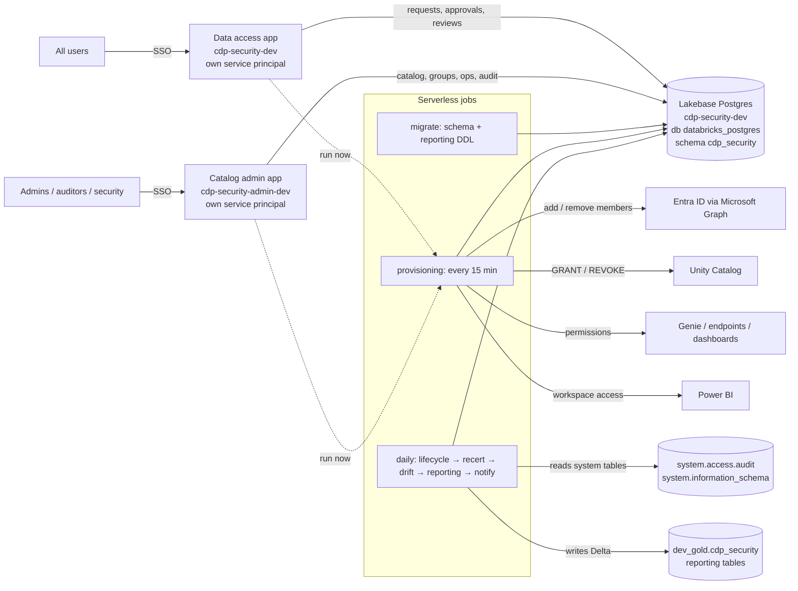

# CDP Security: the complete guide

This guide is for an engineer who is new to Databricks and new to this project. It explains:

1. [What the system does](#1-what-the-system-does)
2. [The Databricks concepts you need](#2-databricks-concepts-you-need)
3. [How the pieces fit together](#3-how-the-pieces-fit-together)
4. [How deployment works, step by step](#4-how-deployment-works-step-by-step)
5. [The dev environment as it exists today](#5-the-dev-environment-as-it-exists-today)
6. [Every file, explained](#6-every-file-explained)
7. [The data model](#7-the-data-model)
8. [Security model](#8-security-model)
9. [Operating it: common tasks](#9-operating-it-common-tasks)
10. [Going to tst / prd](#10-going-to-tst--prd)
11. [Troubleshooting](#11-troubleshooting)
12. [What was changed to get it running](#12-what-was-changed-to-get-it-running)

---

## 1. What the system does

People need access to data (Unity Catalog tables), AI assets (Genie spaces, model endpoints) and Power BI
workspaces. Instead of raising tickets, they use this system:

1. A user **requests** access to something (for example "read access to the member contributions data product").
2. The right people **approve** it. How many approvals depends on how sensitive the data is:
   - GENERAL: data owner (1 stage)
   - CONFIDENTIAL: data owner, then data steward (2 stages)
   - RESTRICTED: data owner, then steward, then security (3 stages)
3. A background job **provisions** it: it adds the user to an Entra ID (Azure AD) group, and that group holds
   the actual Databricks / Power BI permissions. Nobody is ever granted access directly.
4. Access has an **end date**. It expires automatically, and owners must **recertify** (re-confirm) it periodically.
5. A daily job detects **drift**: permissions that were granted outside this system.
6. Every action is written to a **tamper-evident audit trail** (each row contains a hash of the previous row).

There are two web apps over one database:

- **Data access** (`cdp-security-dev`) for everyone: My access, Request access, Approvals, Access reviews,
  My data products, Emergency access (break-glass).
- **Catalog admin** (`cdp-security-admin-dev`) for admins, auditors and security: register data products,
  projects, AI assets and groups; operations (failed provisioning); audit trail and drift findings.

---

## 2. Databricks concepts you need

| Concept | What it is | How this project uses it |
|---|---|---|
| **Workspace** | Your Databricks environment, reached at a URL like `adb-<id>.<n>.azuredatabricks.net`. | Everything is deployed into `adb-7405607693517995.15`. |
| **Unity Catalog (UC)** | Databricks' permission and metadata layer. Data is organised as **catalog → schema → table** (`dev_gold.cdp_security.dim_user`). | Reporting tables go into the existing catalog `dev_gold`, schema `cdp_security`. The provisioning job also issues `GRANT` / `REVOKE` on governed catalogs. **This project never creates catalogs.** |
| **System tables** | Read-only tables Databricks maintains in the `system` catalog, e.g. `system.access.audit` (audit log) and `system.information_schema` (who has which grant). | The drift job reads them to find grants made outside the app. |
| **Declarative Automation Bundles (DABs / Asset Bundles)** | "Infrastructure as code" for Databricks. A `databricks.yml` file describes apps, jobs, databases, etc.; `databricks bundle deploy` creates or updates them. | `databricks.yml` + `resources/*.yml` describe everything. |
| **Target** | A named environment inside a bundle (`dev`, `tst`, `prd`), each with its own workspace URL and variable values. | `dev` is the default; `tst`/`prd` are prepared but not deployed. |
| **Development mode** | `mode: development` on a target: resources are prefixed with `[dev <your name>]`, deployed under your user folder, and run as you. | The dev target. Jobs appear as `[dev naveen9712] cdp_security-...`. |
| **Databricks Apps** | Hosted web apps (Streamlit, Dash, Flask, ...) that run inside Databricks. Users sign in with their normal Databricks login (SSO). Each app gets its **own service principal**. | The two Streamlit apps. |
| **Service principal (SP)** | A non-human identity (like a robot user) identified by an application id (a UUID). | Each app runs as its own SP. In tst/prd, jobs run as a provisioning SP. |
| **On-behalf-of user token** | Apps can receive the signed-in user's token (header `X-Forwarded-Access-Token`), limited by *scopes*. | Used **only** to read the user's own group memberships (default scope `iam.current-user:read`). |
| **Lakebase** | Managed PostgreSQL inside Databricks. You log in with Databricks OAuth (no passwords). | The operational database: requests, approvals, grants, audit trail. Instance `cdp-security-dev`. |
| **Jobs (Lakeflow Jobs) / serverless** | Scheduled or on-demand runs of Python files or notebooks. *Serverless* means Databricks provides the compute; no cluster to manage. | Three jobs: migrate, provisioning, daily. All serverless. |
| **Secret scope** | A named store of secrets (often backed by Azure Key Vault), read with `dbutils.secrets.get`. | Scope `cdp_security` will hold Graph / Power BI / Teams credentials. **Not needed in dev** (dry run). |
| **OAuth U2M / M2M** | U2M = a user logs in through the browser (what you did with `databricks auth login`). M2M = a service principal authenticates with a client id + secret. | You deploy with U2M (profile `Dev`). Apps and jobs authenticate as themselves automatically. |
| **Entra ID groups** | Azure AD security groups. Databricks syncs them, so UC permissions can be granted to them. | Access is granted by adding people to groups named `grp-dbx-<env>-<purpose>-<code>-<level>`. |

---

## 3. How the pieces fit together



### The life of one request

1. **Request.** Alice opens the Data access app and asks for `grp-dbx-dev-dp-member_contributions-read`.
   `service.submit_request` validates it, writes an `access_request` row and a stage-1 `approval_task`,
   writes an audit event and queues a notification to the data owner. All in **one database transaction**.
2. **Approve.** Bob (data owner) sees it on the Approvals page. `service.decide_task` checks segregation of duties
   (Bob is not Alice, did not approve an earlier stage, ...). If more stages remain, the next task is created;
   otherwise an `access_grant` row is created with status `PENDING_PROVISION`. The app then asks the
   provisioning job to run immediately (`kick.trigger_provisioning`).
3. **Provision.** The provisioning job (`engine.run`) turns pending grants into `provisioning_action` rows, then
   executes them: adds Alice to the Entra group through Microsoft Graph. When that succeeds the grant becomes `ACTIVE`.
   In **dry run** (dev) it records everything but calls nothing external.
4. **Use.** Because the *group* already holds `USE CATALOG` / `USE SCHEMA` / `SELECT` on the data product's
   schema (set when the data product was registered), Alice can now query the data.
5. **Expire / recertify / revoke.** When the end date passes, `lifecycle.expire_grants` marks the grant
   `PENDING_REVOKE` and the provisioning job removes the membership. Recertification campaigns ask owners to
   re-confirm; anything not confirmed is revoked.
6. **Report and detect drift.** The daily job copies the data to Delta for reporting and compares desired vs
   actual permissions.

### Key design ideas

- **Desired state vs actual state.** The apps only write *what should be true* to the database. Jobs make it
  true. This is why the apps need no Unity Catalog or Entra permissions at all.
- **Two apps, two identities.** Each app's service principal is its own Postgres role with its own grants
  (`sql/lakebase/roles_template.sql`). Even a bug in the request app cannot change reference data, because
  Postgres refuses it.
- **Everything is audited.** `audit.record` is always called on the same transaction as the change.

---

## 4. How deployment works, step by step

### 4.1 Prerequisites on your laptop

- The Databricks CLI. It ships with the VS Code Databricks extension
  (`~/.vscode/extensions/databricks.databricks-*/bin/databricks`), or install it with
  `brew install databricks/tap/databricks`.
- A logged-in profile (OAuth U2M, opens a browser once):
  ```bash
  databricks auth login --host https://adb-7405607693517995.15.azuredatabricks.net --profile Dev
  databricks auth describe -p Dev          # check who you are logged in as
  ```

### 4.2 What `databricks bundle deploy -t dev -p Dev` does

1. **Reads `databricks.yml`** and every file matched by `include: resources/*.yml`, picks the `dev` target, and
   resolves `${var.*}` variables.
2. **Runs the `preinit` script.** It copies `app/` to `build/admin_app/`. (Two apps may not point at the same
   folder, so the admin app deploys from this copy. Always edit `app/`, never `build/`.)
3. **Uploads the files** to `/Workspace/Users/<you>/.bundle/cdp_security/dev/files` in the workspace
   (respecting `.gitignore`, plus the explicit `sync.include` for `build/admin_app`).
4. **Creates or updates the resources**, comparing with the state it saved last time:
   - Lakebase instance `cdp-security-dev`
   - Apps `cdp-security-dev` and `cdp-security-admin-dev` (+ their permissions)
   - Jobs migrate / provisioning / daily (+ provisioning job permissions)
5. **Saves deployment state** in the workspace, so the next deploy knows what already exists.

Deploying does **not** start the apps with the new code, and does **not** run jobs. You do that with
`bundle run` (below).

### 4.3 First-time setup of an environment (what was done for dev)

| Step | Command / action | Why |
|---|---|---|
| 1 | `databricks bundle deploy -t dev -p Dev` | Creates the Lakebase instance, apps and jobs. |
| 2 | Put the provisioning job id into `databricks.yml` (`provisioning_job_id`) and deploy again | The apps need it to "run now". It can't reference the job directly (that would be a dependency loop: apps → job → apps). |
| 3 | `databricks bundle run -t dev -p Dev cdp_security_migrate` | Creates the Postgres schema `cdp_security`, seeds reference data, grants each app its permissions, creates `dev_gold.cdp_security` reporting tables. |
| 4 | Insert the first admin (see [9.1](#91-add-the-first-admin-once-per-environment)) | Nobody is an admin of a brand-new database. |
| 5 | `databricks bundle run -t dev -p Dev cdp_security_request_app` and `... cdp_security_admin_app` | Deploys the code into the apps and starts them. |

### 4.4 Who runs what (identities)

| Runs | Identity in dev | Identity in tst / prd |
|---|---|---|
| `bundle deploy` | You (OAuth U2M) | A CI/CD service principal (recommended) |
| Jobs | You (development mode runs jobs as the deployer) | The provisioning SP (`run_as` in the target) |
| Data access app | Its own SP (`request_app_role`) | Same |
| Catalog admin app | Its own SP (`admin_app_role`) | Same |

The apps' SP ids are wired automatically
(`${resources.apps.cdp_security_request_app.service_principal_client_id}`) and passed to the migrate job,
which grants each one its database permissions.

### 4.5 Dev versus production behaviour

| Setting | dev | tst / prd |
|---|---|---|
| `dry_run` | `"true"`: decisions are real, but nothing changes in Entra / UC / Power BI | `"false"` |
| Job schedules | `PAUSED` (run them manually) | `UNPAUSED` (15 min / 06:30 daily) |
| Resource names | prefixed `[dev <you>]` | as written |
| Notifications | addressed to you, and only logged (dry run) | sent via Graph mail / Teams |

---

## 5. The dev environment as it exists today

| Item | Value |
|---|---|
| Workspace | https://adb-7405607693517995.15.azuredatabricks.net (CLI profile `Dev`) |
| Data access app | https://cdp-security-dev-7405607693517995.15.azure.databricksapps.com |
| Catalog admin app | https://cdp-security-admin-dev-7405607693517995.15.azure.databricksapps.com |
| Lakebase instance | `cdp-security-dev` (CU_1, PostgreSQL 16), database `databricks_postgres`, schema `cdp_security` |
| Lakebase page | https://adb-7405607693517995.15.azuredatabricks.net/compute/database-instances/cdp-security-dev |
| Reporting | `dev_gold.cdp_security`: 19 tables + 4 views |
| Jobs | `[dev naveen9712] cdp_security-migrate-dev`, `-provisioning-dev` (id 1075004154293681), `-daily-dev` |
| Bundle files in workspace | `/Workspace/Users/naveen9712@hotmail.com/.bundle/cdp_security/dev` |
| First admin | naveen9712@hotmail.com (row in `cdp_security.app_role_member`) |
| Mode | dry run, schedules paused, Entra groups created by hand (`graph_create_groups: false`) |

---

## 6. Every file, explained

### 6.1 Deployment configuration

| File | Deployed how | What it does |
|---|---|---|
| `databricks.yml` | Read by the CLI | Bundle name `cdp_security`; the `preinit` copy step; **variables** (catalog, schema, group names, dry run, ...) and **targets** `dev` / `tst` / `prd` with their workspace URLs and overrides. Start here when you want to change a setting. |
| `resources/lakebase.yml` | Creates a database instance | The Lakebase (Postgres) instance. OAuth logins only (`enable_pg_native_login: false`). No catalog is registered over it. |
| `resources/app.yml` | Creates 2 apps | Both apps: start command (`streamlit run ...`), environment variables (`CDP_SECURITY_*`), the database resource (gives the app's SP `CAN_CONNECT_AND_CREATE` on the Lakebase database) and who may open each app. |
| `resources/jobs.yml` | Creates 3 jobs | The migrate, provisioning and daily jobs: serverless environment (Python packages), schedule, task order, and the parameters passed to every task (`--env`, `--lakebase-instance`, `--reporting-catalog`, ...). |
| `pyproject.toml` | Not deployed | Local tooling: test dependencies, pytest and ruff settings. |
| `app/requirements.txt` | Installed by Databricks Apps at app start | Python packages for the apps: streamlit, databricks-sdk, psycopg. |
| `app/.streamlit/config.toml` | Uploaded with the app | Streamlit theme and server settings (XSRF protection on, no usage stats). |
| `.gitignore` | Used by git and bundle sync | Keeps `build/`, `.databricks/`, caches out of git and uploads. |
| `.vscode/` | Not deployed | Editor settings (Python paths, pytest). |
| `AGENTS.md`, `CLAUDE.md` | Not deployed | Notes for AI coding assistants. |

### 6.2 The apps (`app/`). Deployed by `bundle run <app>`; run by each app's SP

| File | What it does |
|---|---|
| `request_app.py` | Entry point of the **Data access** app. Resolves the user, builds the page menu (Emergency access only for break-glass members) and runs the selected page. |
| `admin_app.py` | Entry point of the **Catalog admin** app. Refuses anyone who is not ADMIN, AUDITOR or SECURITY, then shows Catalog + Operations (admins) and Audit and drift. |
| `views/my_access.py` | Your current access (extend, give up), your requests (cancel), and approval cover (delegation) while you are away. |
| `views/request_access.py` | Pick a group, a project (for confidential / restricted data), a duration and a justification; submit. |
| `views/approvals.py` | Approval tasks you may decide (including as a delegate); approve or reject. Triggers provisioning after an approval. |
| `views/recertification.py` | Access reviews assigned to you: keep or remove each person's access. |
| `views/my_data_products.py` | For data owners: which projects may use your data (link them), and who has access (remove it). |
| `views/break_glass.py` | Emergency 4-hour access with an incident reference (security is alerted and must review). |
| `views/catalog_admin.py` | Admin, in tabs: Workspaces, Data products, Projects, AI and BI assets, Groups and entitlements (activate a group with its Entra object id, members, retire), owners and app roles. |
| `views/operations.py` | Admin: provisioning queue and dead-lettered actions, with retry. |
| `views/audit.py` | Tabs: Audit trail (search, CSV export, hash-chain verification), Drift findings (acknowledge / accept risk / remediate), Evidence pack (CSV for auditors). |

### 6.3 The shared package (`app/cdp_security/`). Used by the apps **and** the jobs

| File | What it does |
|---|---|
| `__init__.py` | Marks the package. |
| `config.py` | Reads all settings from environment variables once (`get_settings()`): environment, group names, dry run, Lakebase instance, time zone, ... |
| `db.py` | Connects to Lakebase. Fetches a short-lived OAuth token as the Postgres password, keeps a connection pool, refreshes tokens. `transaction()` gives you one commit-or-rollback unit. |
| `models.py` | Enumerations (statuses, roles, reasons) and `CurrentUser`. |
| `workflow.py` | **Pure rules, no I/O**: request and grant state machines, approval stages, who may approve (segregation of duties, delegation), SLA due dates in UK business hours, grant end dates. Heavily unit-tested. |
| `service.py` | **Every state change** the apps make: submit / decide / cancel requests, break-glass, revoke, recertify, register data products / projects / assets / AI use cases, entitlements, ownership, delegation, app roles, retries, drift notes. Each function = one transaction + authorisation + audit. |
| `queries.py` | Read-only queries for the pages. |
| `identity.py` | Who is calling: email from the `X-Forwarded-Email` header; app roles from Entra group membership (via the on-behalf-of token) plus `app_role_member` rows. |
| `ui.py` | Small Streamlit helpers: sidebar, tables, status badges, "run this action and show the result". |
| `audit.py` | Writes `audit_event` rows (secrets redacted). The database chains them with hashes. |
| `notify.py` | Queues notifications in `notification_outbox` (the apps never send email directly). |
| `dispatch.py` | Sends queued notifications by Graph mail or a Teams webhook (jobs only). |
| `kick.py` | Asks the provisioning job to run now (best effort; the schedule catches up anyway). |
| `engine.py` | **Provisioning engine** (jobs only): plan actions from desired state, claim them safely, call the providers, retry with back-off, dead-letter after 6 failures. |
| `lifecycle.py` | Daily: expire grants, expiry notices, escalate overdue approvals, leavers / movers, finish retiring groups. |
| `recert.py` | Recertification campaigns: open monthly campaigns, mover reviews, revoke unattested items. |
| `drift.py` | Compares desired grants and memberships with Unity Catalog, `system.access.audit` and Entra; records findings. |
| `naming.py` | Group naming convention `grp-dbx-<env>-<purpose>-<code>-<level>` and its validation. |
| `templates.py` | Default entitlements per group level (e.g. READ = `USE CATALOG` + `USE SCHEMA` + `SELECT`), asset privilege rules. |
| `ucsql.py` | Builds `GRANT` / `REVOKE` SQL safely: allow-listed privileges only, quoted identifiers, only to managed groups. |
| `dbroles.py` | Renders the per-app Postgres grants from `roles_template.sql`. |
| `providers/base.py` | Error types (`DeferError` = try later, `PermanentError` = give up) and an HTTP helper with retries. |
| `providers/entra_graph.py` | Microsoft Graph: find users, create groups, add / remove members, send mail. |
| `providers/uc_grants.py` | Runs UC `GRANT` / `REVOKE` with Spark SQL. |
| `providers/workspace_acl.py` | Permissions on Genie spaces, serving endpoints and dashboards (Databricks Permissions API). |
| `providers/powerbi.py` | Power BI workspace and semantic model access for groups. |

### 6.4 Job entry points (`jobs/`). Deployed as files; run by the jobs

Each is a thin script: parse parameters, set up the package, call one function.

| File | Job / task | What it does |
|---|---|---|
| `_common.py` | (helper) | Parses the shared parameters, sets environment variables, reads secrets, builds the Graph provider. Falls back to `--bundle-root` because serverless runs scripts without `__file__`. |
| `migrate.py` | migrate | Applies `sql/lakebase/NNN_*.sql` once each (tracked with a checksum in `schema_migration`), re-applies the per-app grants, then runs the `sql/reporting/*.sql` DDL in `dev_gold.cdp_security`. Safe to re-run. |
| `provision.py` | provisioning → provision | Expires due grants (so 4-hour break-glass really ends on time), then runs the provisioning engine. |
| `notify.py` | provisioning → notify, daily → notify | Sends queued notifications (only logs them in dry run). |
| `lifecycle.py` | daily → lifecycle | `lifecycle.*` functions. Leavers / movers are skipped without Graph credentials. |
| `recertification.py` | daily → recertification | Closes overdue campaigns, opens new ones. |
| `drift_detection.py` | daily → drift | `drift.run`. Needs read access to the `system` catalog. |
| `reporting_etl.py` | daily → reporting | Copies the Lakebase tables into Spark (over Postgres, no catalog needed) and rebuilds the Delta star schema in `dev_gold.cdp_security`. |

### 6.5 SQL (`sql/`)

| File | Run by | What it does |
|---|---|---|
| `lakebase/001_schema.sql` | migrate job (once) | All operational tables, views, triggers (audit hash chain, append-only audit, `updated_at`). |
| `lakebase/002_seed_reference.sql` | migrate job (once) | Classifications (GENERAL 365 days, CONFIDENTIAL 180, RESTRICTED 90), approval routes, logical groups. |
| `lakebase/003_two_app_security.sql` | migrate job (once) | Lets the request app append audit events without being able to read the audit trail. |
| `lakebase/roles_template.sql` | migrate job (PART 2, every run) | Per-app grants. PART 1 (creating roles) is only needed for tst/prd provisioning SPs. |
| `reporting/001_reporting_ddl.sql` | migrate job (every run, idempotent) | Creates schema `cdp_security` in the existing catalog, plus dimension / fact / audit tables. |
| `reporting/002_reporting_views.sql` | migrate job | Business views: open requests, SLA performance, access by classification, who has access now. |
| `uc/001_platform_grants.sql` | A metastore / catalog admin, by hand, per environment | Unity Catalog grants the provisioning identity needs (MANAGE on governed catalogs, system tables, the reporting schema). |

**Rule:** never edit a Lakebase migration that has been applied (the migrate job fails on a checksum
mismatch). Add `004_....sql` instead.

### 6.6 Tests (`tests/`). Not deployed

| File | What it tests |
|---|---|
| `conftest.py` | Puts `app/` on the import path. |
| `test_workflow.py` | State machines, approval routing, segregation of duties, business hours, grant durations. |
| `test_rules.py` | Group naming, safe GRANT SQL (injection blocked, dangerous privileges blocked), templates, drift comparison. |
| `test_dbroles.py` | Per-app grant rendering. |
| `test_integration_pg.py` | Full end-to-end run against a real PostgreSQL with the production role split (skipped unless `CDP_SECURITY_IT_PG=1`). |

---

## 7. The data model

### 7.1 Operational (Lakebase, schema `cdp_security`)

| Area | Tables |
|---|---|
| Reference | `classification`, `approval_rule`, `logical_group` |
| People and roles | `app_user`, `app_role_member`, `ownership`, `delegation` |
| Catalog | `workspace`, `data_product`, `project`, `project_data_product`, `uc_securable`, `securable_logical_group`, `ai_use_case`, `asset` |
| Groups and permissions | `access_group`, `group_entitlement` |
| Workflow | `access_request`, `approval_task`, `access_grant` |
| Jobs | `provisioning_action`, `recert_campaign`, `recert_item`, `drift_run`, `drift_finding`, `notification_outbox` |
| Audit | `audit_event` (append-only, hash-chained), `schema_migration` |
| Views | `v_group`, `v_request`, `v_grant`, `v_task` |

### 7.2 Reporting (Delta, `dev_gold.cdp_security`)

Dimensions (`dim_date`, `dim_user` (history-tracked), `dim_classification`, `dim_status`, `dim_workspace`,
`dim_project`, `dim_data_product`, `dim_schema`, `dim_access_group`, `dim_asset`), bridges, facts
(`fact_access_request`, `fact_approval_event`, `fact_grant_lifecycle`, `fact_access_snapshot`),
`audit_event_archive`, `drift_finding_history`, and the views `v_open_requests`, `v_sla_performance`,
`v_access_by_classification`, `v_who_has_access_now`. Contains user emails, so grant read access narrowly.

---

## 8. Security model

| Who | How they get the role | Can |
|---|---|---|
| Any user | Can open the Data access app (`users` group) | Request, see own access, approve if they are an owner / steward / sponsor / delegate |
| ADMIN | Entra group `grp-dbx-<env>-app-cdp_security-admin`, or a row in `app_role_member` | Everything in Catalog admin |
| SECURITY | `...-security` group | Approve the RESTRICTED stage 3, review break-glass, accept drift risk |
| AUDITOR | `...-auditor` group | Read audit trail and drift |
| BREAK_GLASS | `...-breakglass` group | Emergency access (4 h, reviewed within 24 h) |

Enforced in three layers: the page menu, the `service.py` checks, and the **database grants per app**. The
request app's Postgres role physically cannot change reference data or read the audit trail.

---

## 9. Operating it: common tasks

### 9.1 Add the first admin (once per environment)

Run as the instance owner, either in the Lakebase query editor (the instance page → **New query**, database
`databricks_postgres`) or with `databricks psql cdp-security-dev -p Dev -- -d databricks_postgres`:

```sql
INSERT INTO cdp_security.app_role_member (email, app_role, granted_by)
VALUES ('you@yourco.com', 'ADMIN', 'bootstrap');
```

Open the admin app in a **new tab** afterwards (roles are cached per browser session). After this, grant
roles from Catalog admin.

### 9.2 Try a full request in dev

1. Catalog admin → **Catalog**: register a data product (catalog `dev_gold`, a schema, an owner and a steward
   who are *not* you). Two groups are planned: `...-read` and `...-write`.
2. Because `graph_create_groups` is false, groups stay **PLANNED** until an admin records their Entra object id.
   In **Groups and entitlements**, record the object id to activate it; in dev (dry run) any placeholder id works.
3. Data access → **Request access**: request the `-read` group.
4. The data owner approves on **Approvals** (you cannot approve your own request).
5. Run provisioning (`bundle run ... cdp_security_provisioning`, or the app triggers it). The grant becomes ACTIVE
   (dry run: no real Entra change).

### 9.3 Change code

| You changed | Do |
|---|---|
| `app/**` | `bundle deploy`, then `bundle run` both apps |
| `jobs/**` or `app/cdp_security/**` used by jobs | `bundle deploy` (jobs read files at run time) |
| `resources/*.yml`, `databricks.yml` | `bundle deploy` |
| New Lakebase migration `sql/lakebase/004_*.sql` | `bundle deploy`, then run `cdp_security_migrate` |
| `sql/reporting/*.sql` | `bundle deploy`, then run `cdp_security_migrate` |

### 9.4 Look at logs

- Apps: workspace → **Compute → Apps** → the app → **Logs**.
- Jobs: workspace → **Jobs & Pipelines** → the job → the run → the task → output / logs.
- From the terminal: `databricks jobs get-run-output <task-run-id> -p Dev`.

### 9.5 Turn off dry run (only with real credentials)

Create secret scope `cdp_security` with `azure-tenant-id`, `graph-client-id`, `graph-client-secret`,
`dbx-sp-client-id`, `dbx-sp-client-secret` (optional `pbi-*`, `mail-sender`, `teams-security-webhook`), create
the Entra app-role groups, then set `dry_run: "false"` for the target and deploy.

---

## 10. Going to tst / prd

1. Set the real workspace `host` and `provisioning_sp` (a service principal application id) for the target in `databricks.yml`.
2. Set `catalog:` to an **existing** catalog in that workspace (the bundle never creates catalogs).
3. Set real `security_mailbox` / `admin_mailbox` (Apps reject empty environment variables).
4. Create the Entra groups `grp-dbx-<env>-app-cdp_security-{admin,security,auditor,breakglass}` and the secret scope.
5. A metastore admin runs `sql/uc/001_platform_grants.sql` for the provisioning SP.
6. `bundle deploy -t tst`, run PART 1 of `sql/lakebase/roles_template.sql` (create the provisioning SP's Postgres
   role) as the instance owner, set `provisioning_job_id`, deploy again, run migrate, seed the first admin, start the apps.

---

## 11. Troubleshooting

These are real errors met while setting up dev, and what they mean.

| Error | Cause | Fix |
|---|---|---|
| `Duplicate app source code path` | Two apps pointing at the same folder | Already solved by the `preinit` copy to `build/admin_app` |
| `The specified scope iam.current-user:read is not a valid scope` | Default scopes may not be listed in `user_api_scopes` | Leave `user_api_scopes` out; Databricks adds the defaults |
| `Must specify environment variable source using either value or valueFrom` | An app env var resolved to `""` | Give every app variable a non-empty value |
| `NameError: name '__file__' is not defined` | Serverless runs job scripts without `__file__` | Handled in every `jobs/*.py` |
| `UC_AZURE_CREDENTIAL_NOT_FOUND` | The catalog's storage credential points to a deleted Azure access connector | Use a catalog with working storage (that's why `dev_gold` is used) |
| `User does not have USE SCHEMA on Schema 'system.access'` | The job identity can't read system tables | A metastore admin grants it (`sql/uc/001_platform_grants.sql`) |
| Catalog admin says "for platform admins ... only" | You have no app role yet | [9.1](#91-add-the-first-admin-once-per-environment), then a new tab |
| Lakebase not under Compute in the UI | Newer UI moved it | Use the direct instance link in [section 5](#5-the-dev-environment-as-it-exists-today) or the app switcher → Lakebase |
| Migrate fails "changed after it was applied" | An applied migration file was edited | Revert it; put the change in a new numbered file |

---

## 12. What was changed to get it running

Starting point: the application code plus a Databricks VS Code project template merged on top of it.

**Configuration**
- Workspace URL set to `adb-7405607693517995.15`; deployed with your OAuth login (profile `Dev`).
- Everything renamed from `secaccess` to `cdp_security` (`cdp-security` where names cannot contain `_`:
  app names, Lakebase instance, app database resource).
- Reporting goes to the **existing** catalog `dev_gold`, schema `cdp_security`. **No catalogs are created**:
  the Lakebase database catalog was removed and the reporting job reads Postgres directly; the app data uses
  the built-in `databricks_postgres` database.
- Dev schedules paused; app SP ids wired automatically; provisioning job permissions for both apps.

**Bugs fixed**
- Two apps sharing one source folder (deploy failure).
- Invalid `user_api_scopes` (deploy failure).
- Empty app env vars (app start failure).
- `__file__` undefined on serverless (all jobs failed).
- Reporting DDL split on `;` inside a string literal (migrate failure).
- **Security:** break-glass access could last ~24 h instead of 4 h; expiry now also runs every 15 minutes.
- Drift findings about group members were auto-"resolved" when Graph wasn't configured.
- The template's test configuration had broken the unit tests.

**Removed as unnecessary**
- VS Code template leftovers: `src/` (taxi sample package, sample notebook, sample pipeline),
  `resources/sample_job.job.yml`, `resources/security_app_etl.pipeline.yml`, `tests/sample_taxis_test.py`, `fixtures/`.
- `app/app.yaml.example` (manual deploy path not used), unused enums `Classification` / `ActionType`,
  unused `slugify`, `group_prefix`, the unused `CDP_SECURITY_APP_MODE` setting, and the duplicate
  `reporting_catalog` / `reporting_schema` variables (use `catalog` / `schema`).

**Known follow-ups (not changed)**
- `service.tasks_for_user` runs several queries per pending task; slow with many tasks.
- `lifecycle.escalate_overdue_tasks` handles all tasks in one transaction; one bad row blocks all escalations.
- Break-glass can target any active group, including RESTRICTED: confirm this matches policy.
- The `grp-dbx-dev-app-cdp_security-*` Entra groups don't exist yet, so their app permissions are not in effect.
