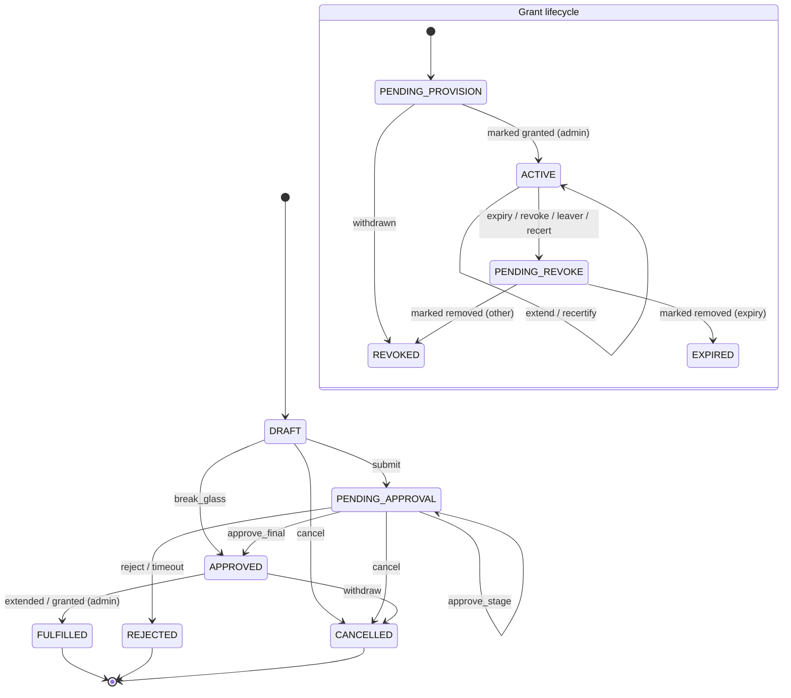
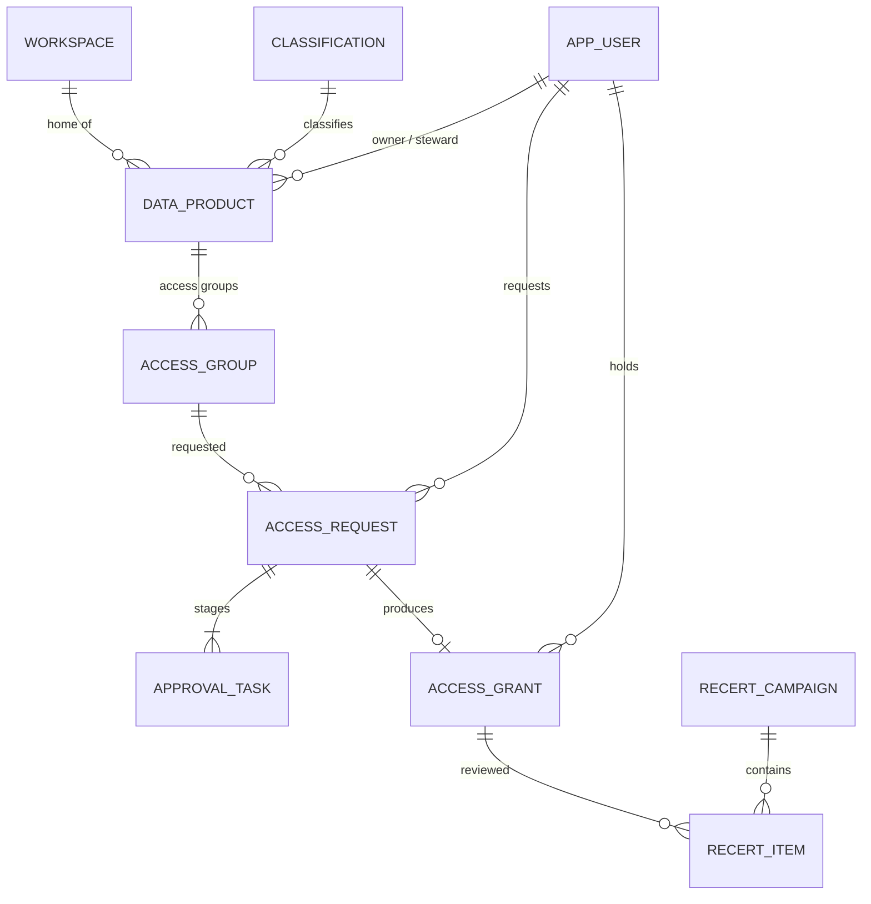
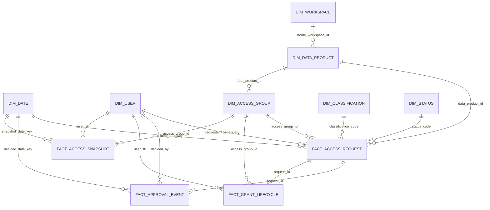

# Data Access Workflow App: requirements specification

Version 1.4, October 2026 (two-app design, simplified catalog, Delta store, manual fulfilment). Status: draft for design governance review.

**Changes in 1.2.** The Catalog admin app registers only workspaces, data products and access groups. Every group gives read access to one data product; admins never choose privileges. Identifiers (WS-0001, DP-0001, GRP-0001) are generated by the app; admins never type ids. Projects, AI use cases, assets, Power BI, logical groups, the ownership register, in-app app-role administration and the rules page are removed. The data owner and steward are fields of the data product. Removed requirements keep their numbers and are marked *Removed in 1.2*.

**Changes in 1.3.** The operational store moves from Lakebase to Delta tables in the app's Unity Catalog schema, read and written through a SQL warehouse (section 4.1). Admins can edit registered workspaces, data products and groups.

**Changes in 1.4.** The app is the record of requests, approvals and manual changes, for audit and reporting; it no longer changes anything itself. Admins add and remove group members by hand and record each change in the Catalog admin app (who, when, note). The provisioning job, entitlement template and drift detection are removed. Data products get a type (Databricks AI/BI dashboard, Power BI, Genie agent, custom agent, Databricks app, schema) and an optional free-text project; catalog and schema are required only for the schema type. Workspace types are Ingestion, Analytics (Power BI), MLOps and Databricks Dashboards. Groups are registered as existing Entra groups, validated before they are saved, and are active at once. Requirements removed in 1.4 keep their numbers.

This document specifies a Databricks App (Python, SQL) that records requests, approvals, manual fulfilment, recertification and revocation of access to the Azure Databricks data platform, for a UK pensions business regulated by the FCA and subject to UK GDPR. The code in this repository implements it; section references (FR-x) are cited in the code where useful.

## 1. Business context

### 1.1 Problem

Access to Unity Catalog data products is granted today through tickets and manual group changes. Approvals are not consistently evidenced, access is rarely removed when no longer needed, and there is no single place that answers "who can see member data, why, and who approved it". This creates conduct and data-protection risk (UK GDPR Articles 5(1)(f) and 32, FCA SYSC 3 and 6 on systems and controls) and makes audit and recertification expensive.

### 1.2 Goals

The app gives every access path a recorded owner, purpose, approval and end date. It tells admins which approved people to add to which Entra ID group, and which to remove when access expires, a person leaves, or a reviewer does not re-confirm it. Admins make each change by hand and record it in the app, so every membership change is attributed. It produces audit evidence and reports on demand. The app holds no permission to change groups or data access.

Success measures: 100% of memberships of registered groups backed by an approved, recorded grant; median time from request to recorded access under 2 working days for General data; median time from approval to recorded manual change under 1 working day; recertification completion above 98% per campaign.

### 1.3 Scope summary

The app registers and maintains three things: workspaces by type (Ingestion, Analytics (Power BI), MLOps, Databricks Dashboards), data products (by type: Databricks AI/BI dashboard, Power BI, Genie agent, custom agent, Databricks app or schema; with an optional project, a data owner and a steward), and Entra access groups. Each access group gives access to exactly one data product. Users request membership of a group; requests are approved, fulfilled by an admin by hand and recorded, expired, recertified and revoked. Every registered item gets a generated identifier (WS-0001, DP-0001, GRP-0001).

### 1.4 Stakeholders

| Stakeholder | Interest |
|---|---|
| Data consumers (analysts, actuaries, data scientists) | Fast, predictable access with clear status |
| Data owners (business heads per data product) | Control over who uses their data and why |
| Data stewards | Correct classification and appropriate use |
| Information security | Least privilege, break-glass control, attributed manual changes |
| Data protection officer | Lawful, minimal, time-bound access to personal data |
| Platform team | Fewer tickets, a clear to-do list of approved adds and due removals |
| Internal audit / 2nd line risk | Complete, tamper-evident evidence |
| Identity (Entra) team | Group hygiene, naming and lifecycle |

### 1.5 Applications and in-app roles

The solution is two Databricks Apps over one schema of Delta tables, reached through a SQL warehouse:

| App | Audience | Purpose |
|---|---|---|
| **Data access** (`cdp-security-<env>`) | Every user | Request, extend and give up access; approve; review access; emergency access; data-owner tools (who has access to my data) |
| **Catalog admin** (`cdp-security-admin-<env>`) | Platform admins, auditors, security | Register and edit workspaces, data products and access groups; record manual adds and removals (Fulfilment); audit trail and evidence |

| Role | Source | Can do |
|---|---|---|
| Requester | Any signed-in user | Request access for self or another person, extend, cancel own requests, give up access, set approval delegates |
| Approver | Contextual: data owner or steward of the data product the requested group belongs to, their delegate, or a security approver | Approve or reject the stage assigned to their role |
| Data owner | Named as data owner on a data product | Approve, revoke access to their data, review access in campaigns |
| Steward | Named as steward on a data product | Second-stage approval for Confidential and Restricted; fallback recertification reviewer |
| Admin | Entra group `grp-dbx-<env>-app-cdp_security-admin` | Register workspaces, data products and groups, retire groups, record manual adds and removals (never for their own access). Cannot approve requests by virtue of the role |
| Auditor | Entra group `...-auditor` | Read audit trail and evidence; no changes |
| Security | Entra group `...-security` | Approve Restricted stage 3, review break-glass |
| Break-glass | Entra group `...-breakglass` | Obtain time-boxed emergency access with post-hoc review |

Admin, auditor, security and break-glass come only from membership of their Entra groups. They are not maintained in the app.

## 2. Functional requirements

Each requirement is testable. "Must" is mandatory for go-live.

### 2.1 Reference data management

- **FR-1** An admin must be able to register a workspace with name, type (INGESTION, ANALYTICS_PBI, MLOPS, DATABRICKS_DASHBOARDS), URL and environment. URLs must be https. The app derives the Databricks workspace id from the URL; the admin does not enter it.
- **FR-2** An admin must be able to register a data product with a name, type (DATABRICKS_DASHBOARD, POWER_BI, GENIE_AGENT, CUSTOM_AGENT, DATABRICKS_APP, SCHEMA), description, optional free-text project, catalog and schema, classification, home workspace, data owner email and steward email. Catalog and schema are required for the SCHEMA type and optional for the others; a schema needs its catalog. Data product names are unique; a schema can be registered as only one SCHEMA-type data product. For Confidential and Restricted, owner and steward must be different people. An admin may later change the owner or steward on the data product.
- **FR-3** Registering a data product must not create any groups. Groups are registered separately (FR-9).
- **FR-4** *Removed in 1.2* (projects are out of scope).
- **FR-5** *Removed in 1.2* (project links).
- **FR-5a** Owners and stewards must be able to see, in the Data access app, who currently has access to their data products, and owners must be able to remove a person's access.
- **FR-6** *Removed in 1.2* (AI, BI and Power BI assets are out of scope).
- **FR-7** *Removed in 1.2* (AI use cases).
- **FR-8** *Removed in 1.2* (logical groups).
- **FR-9** An admin must be able to register an existing Entra group by typing its name and choosing one data product of any type. The group must pass validation before it is saved: the name is 3 to 256 characters (letters, digits, spaces and `. _ - ( )`), no other registered group has the same name (ignoring case), and the data product is active. The admin sees the result of each check and can save only once all pass for the values shown; saving runs the checks again. The app suggests `grp-dbx-<env>-dp-<name>-read`. A data product may have several groups; a group belongs to exactly one data product. Whether the group really exists in Entra ID is checked by the admin.
- **FR-10** *Removed in 1.4* (the app records no entitlements; admins give each group its permissions on the dashboard, report, agent, app or schema by hand).
- **FR-10a** *Removed in 1.4* (groups are registered as existing groups and are active at once; the app does not look them up in Entra).
- **FR-11** Approval routes and classification limits must be changeable only by database migration (that is, through design governance). They are not shown or edited in the Catalog admin app.
- **FR-12** A change of data owner or steward must be recorded in the audit trail with the old and new person.
- **FR-12a** Identifiers must be generated by the app from a database sequence per type: `WS-nnnn` for workspaces, `DP-nnnn` for data products, `GRP-nnnn` for groups. They are never reused, cannot be edited, and are shown in both apps and in the reporting tables.
- **FR-12b** An admin must be able to edit a registered workspace, data product or active group. Every edit is audited with the old and new values. A group edit passes the same validation as registration (FR-9). A group can be linked to another data product only while it has no members and no open requests.

### 2.2 Request workflow

- **FR-13** A user must be able to request a requestable group for themselves or another person (chosen from the workspace's users, or by typing an email), with a justification of at least 20 characters and an end date (dd-mm-yyyy, default 01-01-2030).
- **FR-14** *Removed in 1.2* (no project is needed; the justification states the purpose).
- **FR-15** *Changed in 1.4:* there is no upper limit on the end date; approvers see it and decide. The end date must be after today. (The classification's `max_grant_days` is no longer enforced; periodic recertification still applies.)
- **FR-16** A person may have only one open request and one live grant per group; duplicates must be refused with guidance to extend instead.
- **FR-17** Each request must receive a human-readable reference (SAR-nnnnnnn).
- **FR-18** A requester or beneficiary may cancel a request while it is pending approval. Approved requests cannot be cancelled (revoke the grant instead); an approved request whose member was never added is withdrawn when its group is retired or the person leaves.
- **FR-19** A grantee may request an extension of an active, non-break-glass grant; it follows the same approval route; on approval the end date is moved, not a new grant created.
- **FR-20** Users must see status, current stage and history of their requests.

### 2.3 Approval rules by classification

- **FR-21** Stages are sequential: General = data owner; Confidential = data owner, then steward; Restricted = data owner, then steward, then security.
- **FR-22** If a classification has no configured stages or has gaps, requests must fail closed with an error.
- **FR-23** The requester and beneficiary can never approve any stage of their own request.
- **FR-24** A person may approve at most one stage of a request.
- **FR-25** An approver may delegate to another person for up to 60 days; delegates decide "on behalf of" and this is recorded. Delegation does not pass authority from a conflicted person.
- **FR-26** Rejection requires a comment of at least 5 characters.
- **FR-27** Each stage has an SLA in UK business hours (weekends and configured bank holidays excluded). On breach the task is escalated to approvers and admins; after the auto-reject threshold (default 240 business hours past due) the request is closed.
- **FR-28** If no eligible approver exists for a stage, admins must be alerted immediately.
- **FR-29** The data owner and steward are those recorded on the data product of the requested group.

### 2.4 Fulfilment (manual)

- **FR-30** Final approval must create a grant awaiting fulfilment and alert the admin mailbox. The app never changes a group or a permission.
- **FR-31** An admin adds the person to the group by hand, then marks the grant granted in the Catalog admin app, with an optional note (for example a change ticket). The app records who and when, the grant becomes active, the request fulfilled; access ends on the date approved (emergency access gets its full duration from that moment). The person is notified.
- **FR-32** Access that is revoked, or whose end date has passed, must be listed for removal. An admin removes the person by hand and marks it removed, with an optional note; the app records who and when and notifies the person.
- **FR-33** Marking granted or removed must succeed once only; if two admins act at once, the second is told it has already changed.
- **FR-33a** An admin cannot record access given to themselves; another admin must do it.
- **FR-34** *Removed in 1.4* (no automated retries).
- **FR-35** *Removed in 1.4* (no sync deferral).
- **FR-36** *Removed in 1.4* (the app does not create Entra groups).
- **FR-37** A dry-run mode logs notifications instead of sending them.

### 2.5 Lifecycle

- **FR-38** Expiry: access must be listed for removal from its end date. Notices are sent 14 and 3 days before.
- **FR-39** Recertification: each grant must be re-confirmed within its classification interval (General 365, Confidential 180, Restricted 90 days). Items are added 14 days before due; the reviewer is the data owner, falling back to the steward, never the grantee.
- **FR-40** Items not reviewed by the campaign due date must be revoked (fail closed) and listed for removal.
- **FR-41** Leavers: a person disabled or deleted in Entra must have all access listed for removal within one daily cycle; access approved but not yet added is withdrawn; their open requests are cancelled; admins are told about data products they were owner or steward of.
- **FR-42** Movers: a department change must place the person's grants in a mover review campaign due in 7 days.
- **FR-43** Joiners receive no access automatically.
- **FR-44** Break-glass: members of the break-glass group may obtain access to an active group with an incident reference; admins are alerted to add the person at once and it is listed first on the Fulfilment page; it lasts 4 hours (configurable) from when it is marked granted, cannot be extended, alerts security by email and Teams immediately, and must be reviewed by security within 24 hours. A rejected review revokes access and raises a security alert.
- **FR-45** Retiring a group must list all members for removal, withdraw access approved but not yet added, and cancel open requests; the group is marked retired once the last member is recorded as removed.

### 2.6 Notifications

- **FR-46** Notifications must be written to an outbox in the same transaction as the change and sent by a job (email via Graph from a service mailbox; security alerts also to a Teams channel).
- **FR-47** Messages carry request metadata only, never data content.
- **FR-48** Non-production messages must be prefixed with the environment.
- **FR-49** Failed sends retry up to 5 times and are visible to admins.

### 2.7 Reporting and audit views

- **FR-50** Auditors must be able to search the audit trail by date, actor and reference, export it as CSV, and verify its integrity.
- **FR-51** An evidence pack must list every live grant with classification, data product and type, dates, last recertification, the full approval trail, and who added the member.
- **FR-52** A daily star schema in Delta must support reporting on request volumes, SLA performance, access by classification, overdue recertification and break-glass use. A view must show, per grant, who added and removed the member and how long after approval or revocation.
- **FR-53** *Removed in 1.4* (drift detection).

## 3. Workflow state model

### 3.1 Request states

| From | Event | To | Triggered by |
|---|---|---|---|
| DRAFT | submit | PENDING_APPROVAL | requester |
| DRAFT | break_glass | APPROVED | break-glass member |
| DRAFT, PENDING_APPROVAL | cancel | CANCELLED | requester, beneficiary |
| PENDING_APPROVAL | approve_stage | PENDING_APPROVAL (next stage) | eligible approver |
| PENDING_APPROVAL | approve_final | APPROVED | eligible approver |
| PENDING_APPROVAL | reject | REJECTED | eligible approver |
| PENDING_APPROVAL | timeout | REJECTED | system (SLA) |
| APPROVED | extended | FULFILLED | approver (EXTEND requests) |
| APPROVED | granted | FULFILLED | admin, after adding the member by hand |
| APPROVED | withdraw | CANCELLED | admin, system (group retired, leaver) |

### 3.2 Grant states

| From | Event | To |
|---|---|---|
| PENDING_PROVISION (awaiting admin) | granted (admin, by hand) | ACTIVE |
| PENDING_PROVISION | withdraw (group retired, leaver) | REVOKED |
| ACTIVE | extend, recertify | ACTIVE |
| ACTIVE | revoke (self, owner, admin, expiry, recert, leaver, post-hoc rejection, group retired) | PENDING_REVOKE |
| PENDING_REVOKE (awaiting admin) | removed (admin, by hand) | EXPIRED (if reason is expiry) or REVOKED |
| ACTIVE past its end date | removed (admin, by hand) | EXPIRED |

### 3.3 SLAs and escalation

| Item | SLA | Escalation |
|---|---|---|
| General, owner stage | 72 business hours | Email approvers and admins at breach; close at 240 hours past due |
| Confidential, each stage | 72 business hours | As above |
| Restricted, each stage | 48 business hours | As above; security stage also alerts the security channel |
| Break-glass review | 24 calendar hours | Security channel and admins; never auto-closed |
| Manual add after approval | 1 working day target (break-glass: immediately) | Admin mailbox alerted at approval; tracked in `v_manual_fulfilment` |
| Leaver listed for removal | Next daily run (06:30) | Admin mailbox alerted |

## 4. Data model

### 4.1 Operational model and store choice

The operational model is normalised and lives in **Delta tables** in the app's schema (dev: `dev_gold.cdp_security`), next to the reporting model. Both apps and all jobs read and write through one SQL warehouse.

Delta gives atomic changes per table only, and does not enforce primary or foreign keys. The design keeps its rules as follows:

| Need | How it is met on Delta |
|---|---|
| A rule must hold when two people act at once (one open request per person and group, a task decided once, unique names) | Each such rule is one statement that checks and changes together (`INSERT ... SELECT ... WHERE NOT EXISTS`, `UPDATE ... WHERE status = <expected>`); the affected row count is checked |
| Two such statements race on one table | Every table uses Serializable isolation; the losing statement fails with a conflict and is retried |
| Generated identifiers without gaps (WS-, DP-, GRP-, SAR-) | `max + 1` computed inside the inserting statement |
| A change that touches several tables (approve: task, request, grant, audit) | Validation first; then single-table writes in a fixed order, each guarded by the expected state; the audit event straight after the change. A failure part-way leaves a state the next step or an admin can resolve |
| Valid values | CHECK constraints (enforced by Delta) |
| Append-only audit with hash chain | `delta.appendOnly` blocks UPDATE and DELETE; the hash and sequence are computed inside the inserting statement |
| Manual fulfilment recorded once | `UPDATE access_grant ... WHERE status = 'PENDING_PROVISION'` (or `'PENDING_REVOKE'`); the row count tells the second admin it already changed |
| Reporting | Same schema: no copy job; dimensions are views, history and facts are refreshed daily |

Trade-offs accepted: each page load and change costs warehouse queries (seconds when the warehouse is cold, warehouse time per interaction); integrity across tables relies on the application's ordering rather than database transactions.

Main operational tables: `classification`, `app_user`, `workspace`, `data_product`, `access_group`, `approval_rule`, `delegation`, `access_request`, `approval_task`, `access_grant`, `recert_campaign`, `recert_item`, `notification_outbox`, `audit_event`. Full DDL: `sql/delta/`.

| Table | Generated identifier | Entered by the admin |
|---|---|---|
| workspace | `workspace_code` WS-nnnn | name, type, URL, environment |
| data_product | `data_product_code` DP-nnnn | name, type, description, project (optional), catalog and schema (required for the schema type), classification, home workspace, owner, steward |
| access_group | `group_code` GRP-nnnn | group name, data product |
| access_grant | internal | who added / removed the member and a note (Fulfilment page) |

### 4.2 Dimensional model for reporting and audit

Location: the same schema as the operational tables. Refreshed daily by `jobs/reporting_etl.py`. DDL: `sql/reporting/reporting.sql`.

| Table | Type | Grain |
|---|---|---|
| fact_access_request | Transaction fact | One row per access request |
| fact_approval_event | Transaction fact | One row per approval task (stage) of a request |
| fact_grant_lifecycle | Accumulating snapshot | One row per grant; milestones (requested, approved, added by hand, recertified, revoke requested, removed by hand) filled as they occur |
| fact_access_snapshot | Periodic snapshot | One row per live grant per day (partitioned by date) |
| dim_user | SCD type 2 | One row per version of a user (department, active status) |
| dim_access_group, dim_data_product (with type and project), dim_workspace, dim_classification, dim_status, dim_date | SCD type 1 | One row per entity, keyed and labelled with the generated identifier |
| v_manual_fulfilment | View | One row per grant: who added and removed the member, notes, hours from approval to add and from revocation to removal |

Facts join to `dim_user` at the point in time of the event (SCD2 effective dates), so a report shows the department a person was in when they were approved.

## 5. Fulfilment approach

The app records requests, approvals and manual changes; **people change the groups**. Nothing in the app or its
jobs calls Entra ID to change a group, or grants anything in Unity Catalog, Power BI or a workspace.

1. **Approve.** The final approval creates a grant awaiting fulfilment and alerts the admin mailbox (break-glass:
   marked urgent).
2. **Add by hand.** An admin adds the person to the group in Entra ID, then marks the grant granted on the
   Fulfilment page (optional note, for example a change ticket). Access ends on the date approved.
3. **Remove by hand.** Revoked access, and access past its end date, is listed on the Fulfilment page. An admin
   removes the person from the group and marks it removed.
4. **Record.** Each mark is one guarded update (it succeeds once), followed by its audit event and a
   notification to the person.

**Group permissions.** When a group is registered, an admin gives it its permissions on the data product once, by
hand: sharing the AI/BI dashboard, Power BI report, Genie space, agent or app with the group, or granting it
`USE CATALOG`, `USE SCHEMA` and `SELECT` on a schema. The app does not record or check these.

**Entra group lifecycle.**

| Stage | What happens |
|---|---|
| Active | Created in Entra by the identity team; registered by an admin in the Catalog admin app after validation (FR-9), linked to one data product |
| Retiring | Requestable switched off, members listed for removal, approved-but-not-added access withdrawn |
| Retired | The last member is recorded as removed; the identity team may delete the Entra group |

**Suggested naming.** `grp-dbx-<env>-<purpose>-<name>-<level>`

| Purpose | Name | Levels | Example |
|---|---|---|---|
| dp (data product access, registered in the app) | chosen by the admin | read | grp-dbx-prd-dp-member_contributions-read |
| app (this app's roles) | cdp_security | admin, security, auditor, breakglass | grp-dbx-prd-app-cdp_security-admin |

## 6. Security of the app

**Identities.** Each app runs as its own service principal with access to the app's own tables only (no privileges on the data products). The jobs run as a separate jobs service principal with access to the app's schema and, when notifications are switched on, Graph credentials for mail and user lookups only. No identity of this system holds MANAGE on data or any permission to change Entra groups. The Catalog admin app can only be opened by the admin, auditor and security groups.

**On-behalf-of versus app identity.** User authorisation is enabled with a single scope, `iam.current-user:read`, used only to read the caller's group memberships for role resolution. All writes are made by the App service principal and attributed to the user in the audit trail. Using OBO for writes is rejected because it would require every user to hold write rights on the app's tables.

**Least privilege in Unity Catalog.** All tables sit in one schema; separation is enforced by per-table grants to each app's service principal (`app/cdp_security/appgrants.py`), re-applied by the migrate job after every run.

| Table group | Data access app | Catalog admin app | Jobs (schema owner) |
|---|---|---|---|
| classification, approval_rule | read | read | owner (changed by migration only) |
| workspace, data_product, access_group | read | read, modify | owner |
| access_request, approval_task, access_grant | read, modify | read, modify (fulfilment, retire group) | owner |
| delegation, recert_item, recert_campaign | read (modify: delegation, recert_item) | read | owner |
| app_user, notification_outbox | read, modify | read, modify | owner |
| audit_event | read, append | read, append | owner |

Nobody can UPDATE or DELETE audit rows (`delta.appendOnly`), and neither app can change approval rules. Appending computes the next hash from the previous event, so both apps can read the audit trail. A write attempted by the wrong app is refused by Unity Catalog, not just by application code. Readers of the whole schema (auditors, security) get `SELECT` on the schema.

**Network.** The App and jobs run on serverless compute. Warehouse traffic stays inside Databricks. Serverless egress (network policies under your NSP/NCC design) must allow only `login.microsoftonline.com`, `graph.microsoft.com` and the Teams workflow host. The App should be reachable only through the workspace (private link front-end where used). No secrets are stored in code or in tables; credentials live in a Key Vault-backed secret scope readable only by the jobs SP.

**Segregation of duties.** Administering the catalog and approving access happen in different apps under different database roles: the Catalog admin app cannot create requests or approval decisions at all. Requesters and beneficiaries cannot approve; one person approves at most one stage; admins administer and fulfil but do not approve, and cannot record access given to themselves; data owner and steward must differ for Confidential and Restricted; reviewers cannot recertify their own access; app roles are managed only in Entra; approval routes change only through governed migrations.

**Application hardening.** Parameterised SQL everywhere; catalog, schema and group names are checked against allow-listed characters; the app issues no GRANT statements on data; XSRF protection on; errors shown to users never include stack traces.

## 7. Audit and compliance

**Append-only event log.** Every state change writes an `audit_event` row straight after the change, with actor, action, object, before and after state, reason and correlation id (the request reference). The inserting statement assigns a strictly increasing sequence and a SHA-256 hash chained to the previous event; `delta.appendOnly` blocks UPDATE and DELETE. The chain verification query proves integrity and is available on the Audit page.

**Retention.** The audit trail is itself an append-only Delta table. Recommended retention: 7 years after the end of the access relationship, aligned with your records retention schedule; confirm with Compliance and the DPO. After retention, personal identifiers should be pseudonymised rather than rows deleted, preserving chain verification of the remaining fields.

**Evidence for recertification.** For each campaign: the item, reviewer, decision, timestamp and comment; for each live grant, the evidence pack (FR-51) shows approvals and last recertification. Unattested items are revoked automatically (listed for removal) and evidenced as `RECERT_NOT_ATTESTED`; the removal records the admin who made it.

**GDPR.** Processing purpose: security of processing and access control (Art. 32), lawful basis legitimate interests and legal obligation. Data minimisation: the app stores work email, display name and department only. Reporting tables containing emails are restricted to auditors and security. Subject access requests can be answered from the audit and grant tables.

**FCA alignment.** Supports SYSC 3.2 and 6.1 systems and controls, operational resilience evidence (who could access important business services' data), and SM&CR accountability through named data owners.

## 8. Non-functional requirements

| Area | Requirement |
|---|---|
| Environments | dev, tst, prd, each with its own schema, SQL warehouse, apps and groups. Dev runs in dry-run mode (notifications logged, not sent) |
| Deployment | Databricks Asset Bundle (`databricks.yml`); CI runs unit tests and `bundle validate`, then deploys to tst; prd deployment requires a governance approval gate |
| Schema change | Numbered, checksummed migrations (`sql/delta/`) applied by `cdp_security-migrate`; applied files cannot be edited |
| Performance | Page loads under 3 seconds at 95th percentile for up to 200 concurrent users once the warehouse is running; submit or decide under 3 seconds |
| Throughput | Hundreds of requests and manual changes per hour; the audit hash chain serialises writes to the audit table (conflicts are retried), which is adequate at this volume |
| Availability | Business hours 99.5%; if the App is down, existing access is unaffected and admins catch up on the Fulfilment page afterwards |
| Recovery | Delta time travel (`RESTORE TABLE`) within the retention period; RPO 15 minutes, RTO 4 hours |
| Observability | Job run history and failure alerts; Fulfilment page for outstanding adds and removals and failed notifications; structured logs with error references |
| Accessibility | WCAG 2.2 AA for custom content; Streamlit defaults otherwise |
| Cost | SQL warehouse time per interaction (serverless, stops when idle), compute for two apps (the Catalog admin app can be stopped out of hours), a 15-minute notification job (about 96 short runs a day) and one daily job. Paused in dev |
| Security testing | Penetration test of the App before go-live; quarterly access review of the app's own admin groups |

## 9. Assumptions, open questions, risks and scope

### 9.1 Assumptions

- A1. Entra ID is the identity source; groups sync to Databricks via automatic identity management or SCIM.
- A2. All governed workspaces share one Unity Catalog metastore.
- A3. A SQL warehouse (serverless recommended) is available in each environment.
- A4. A dedicated jobs service principal can be given access to the app's schema and, for notifications, Graph `Mail.Send` and `User.Read.All`.
- A5. Groups are created in Entra ID by the identity team, and their permissions on each data product are set by hand; the app's classification matches the data's classification tags.
- A6. A service mailbox and a security Teams channel exist for notifications.

### 9.2 Open questions for you

1. Is there an ITSM tool (for example ServiceNow) that must remain the system of record for requests? If so, the fulfilment note can carry its ticket number, or an integration can be added.
2. Should the app later check, read-only, that a registered group exists in Entra ID and that members match the recorded grants (needs a Graph secret with `Group.Read.All`)?
3. Should Restricted access also need line-manager approval? If so, a manager source (Entra `manager` attribute) is needed.
4. Who are the security approvers and break-glass members, and what is the break-glass duration your security policy accepts?
5. Should the app sync UC classification tags from CI/CD into its own records, or is the app the source of the classification?
6. Retention period for the audit archive and the pseudonymisation approach after it.
7. Should the app later make the group changes itself (automated provisioning) once the manual process is proven?
8. Which workspaces host the App in each environment, and is front-end private link in use?
9. Without projects, Confidential and Restricted access is justified by free text only. Is that acceptable to the data owners and the DPO?

### 9.3 Risks

| Risk | Impact | Mitigation |
|---|---|---|
| Manual changes not made, or not recorded | Approved people wait; removed access lingers; records and Entra disagree | Admin mailbox alerts on every approval and revocation; Fulfilment to-do lists; `v_manual_fulfilment` reports time to act; periodic reconciliation of group members against live grants by the identity team |
| A change is recorded but not made | Records claim access was removed when it was not | Attributed marks with notes (change ticket); recertification; reconciliation |
| Warehouse unavailable or slow | Requests and approvals blocked or slow | Existing access unaffected; serverless warehouse with auto-stop; monitor query history |
| No multi-table transactions | A failure part-way through an operation leaves related rows out of step | Guarded single-statement writes in a fixed order; audit after each change; admins and jobs reconcile |
| Owners not maintained | Requests stall, reviews fail | No-approver alerts, leaver-owner alerts, delegation |
| Review fatigue | Rubber-stamping | Monthly buckets, per-reviewer summaries, reports on keep-rate per reviewer |
| Restricted data in justifications | Personal data in free text | Guidance text in the form, retention controls |

### 9.4 Out of scope

- Automated provisioning: creating groups, changing memberships or granting permissions (done by hand and recorded).
- Drift detection against Unity Catalog or Entra ID.
- Row filters, column masks and ABAC policy authoring (fine-grained controls stay with your governance CI/CD).
- Granting compute, cluster policies or SQL warehouse entitlements.
- Azure resource RBAC, storage account and Key Vault access.
- Unity Catalog object ownership transfers.
- Access for service principals and pipelines (managed through infrastructure as code).
- Self-service creation of new data products (registration only).
- Delta Sharing recipients.
- Projects and project-based access.
- Managing the dashboards, reports, agents and apps themselves (the app records access to them as data products only).
- Write access to data products (granted to pipelines through infrastructure as code).
- Logical groups (tagging tables and schemas).
- Owners for objects other than data products, and app-role administration inside the app (Entra only).
